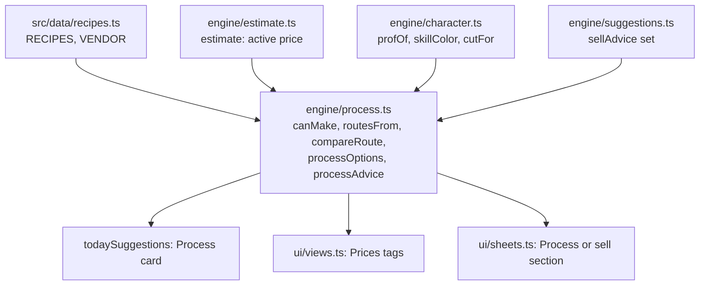

# Detailed design: T8, process or sell

## 1. Overview

Forever Market Ledger's sell advice today looks at each material on its own: list now, or hold for a better window. It never asks whether the character would keep more gold by **processing** a material first, e.g. smelting ore into bars, brewing herbs into elixirs, or converting Light Leather into Medium.

T8 adds that comparison. For each material the character holds or gathers, the engine lists the recipes the character can make from it, up to two steps (ore → bar → alloy). It compares gold kept per craft after the auction house cut: sell the inputs raw, or make the output and sell that. A recipe is recommended only when it clearly wins. The result shows in three places: the material sheet (full breakdown), a tag on Prices rows, and a "Process" card on Today.

The engine stays pure (it takes `now` and the data it needs), makes no AI or network calls, and gives no market-manipulation advice. It never suggests buying inputs to craft and resell.

## 2. Detailed requirements

From the grill (Nov 18, 2026, rounds 1–3):

1. **Outputs:** only the 136 catalogued materials, which have item IDs and API prices. No pipeline change. (Q1)
2. **Conversions in scope:**
   - **Mining smelting:** Copper, Tin, Silver, Iron, Gold, Mithril, Truesilver, Thorium Bars; alloys Bronze (Copper Bar + Tin Bar, makes 2) and Steel (Iron Bar + Coal).
   - **Dark Iron Bar:** only when the character is on-level for the Black Forge in Blackrock Depths. (Q2, Q12)
   - **Arcanite Bar (Alchemy transmute):** for Alchemists with the skill. Shown as "if you know the recipe" with the recipe's vendor and "once every 2 days (est.)". (Q2, Q13, Q19)
   - **Alchemy:** the catalogued mana potions and elixirs, except Elixir of Superior Defense (its Stonescale Oil input isn't catalogued). Drop and vendor recipes are shown with "if you know the recipe (<source>)". (Q4, Q6, Q18)
   - **Leatherworking:** Light → Medium → Heavy → Thick → Rugged Leather. (brief, research)
   - **Out of v1:** First Aid healing potions (conflicting data), so a T6 follow-up. (Q17)
3. **Chains:** model each recipe with its real inputs. From a raw material, consider routes of one or two steps; never deeper. (Q3)
4. **Whose materials:** the same set as sell advice (priced plus gathered). A route's inputs must all be in that set for Today and Prices. The material sheet may show routes whose other inputs you don't hold. No buy-to-craft suggestions. (Q5, Q14)
5. **Recipe knowledge:** trainer recipes count as known once skill reaches their requirement. Others carry "if you know the recipe" and their source. (Q6)
6. **Comparison:** gold kept per craft. Both sides use `estimate(...).now`, the active price (API p10 or manual) that sell advice uses. (Q7)
   - Process = output count × output price × (1 − home cut) − vendor reagent cost.
   - Raw = Σ input count × input price × (1 − home cut).
7. **Threshold:** recommend processing when process − raw > 10% of raw **and** ≥ 1 silver (100 copper) per craft. (Q8)
8. **Missing price:** no advice on Today or Prices. The sheet lists the route with "No price for <item> yet: add one to compare". (Q9)
9. **Where it shows:** (Q10)
   - The material sheet gets a "Process or sell" section.
   - Prices rows (your prices and Market) get a tag such as "Smelt first +18%".
   - Today gets one "Process" card with up to two routes.
   - Session is unchanged.
10. **Skill-ups:** the comparison is gold only. When the final recipe is orange or yellow for the character, add "also gives skill-ups". (Q11)
11. **Data sources:** every recipe ratio, skill and vendor price has a source. Forever where published, otherwise Classic marked `est: true`. (brief)
12. **Tests and lock:** unit tests for the comparison, plus an e2e spec at 412×900. The behavior lock should not change, because no reference character has Mining, Alchemy or Leatherworking. If it does change, stop and explain. (Q15)
13. **Delivery:** SPEC backlog entry T8, branch `t8/process-or-sell`, one PR, ask before pushing. (Q16)

## 3. Architecture overview



- **Data** (`src/data/recipes.ts`): typed recipe table and vendor reagent prices, each entry citing its source.
- **Engine** (`src/engine/process.ts`): pure functions. Input: character, `SugCtx` (`now`, items, toggles, market). Output: plain objects the UI formats.
- **UI:** three small render additions. No new state, storage or network.

`SMELT` in `src/data/gathering.ts` stays as it is. It feeds `canGather` ("mine and smelt") and the zone dossier, and the behavior lock covers those. A data test checks that every `SMELT` bar has a recipe.

## 4. Components and interfaces

### 4.1 `src/data/recipes.ts`

```ts
export type Prof = "Mining" | "Alchemy" | "Leatherworking";
export type Recipe = {
  out: string;               // catalog name (MAT / ITEM_ID)
  n: number;                 // outputs per craft
  prof: Prof;
  skill: number;             // skill to learn and craft
  colors?: [yellow: number, green: number, grey: number]; // when the source gives them
  ins: [name: string, count: number][];    // catalogued inputs
  vendor?: [name: string, count: number][]; // vendor reagents (VENDOR keys)
  learn: "trainer" | string; // otherwise where the recipe comes from
  verb: "Smelt" | "Brew" | "Transmute" | "Convert";
  where?: string;            // e.g. "the Black Forge in Blackrock Depths"
  minLevel?: number;         // level + zone reach must reach this (Dark Iron: 52)
  cooldown?: string;         // "once every 2 days"
  est?: true;                // some number not confirmed for Forever
  src: string;               // source URL or short reference
};
export const RECIPES: Recipe[];
export const VENDOR: Record<string, { price: number; src: string; est?: true }>; // copper per unit
```

### 4.2 `src/engine/process.ts`

```ts
export type Route = { steps: Recipe[]; ins: [string, number][]; vendorCost: number; out: string; n: number };
export type Compared = Route & {
  keepRaw: number | null; keepProcess: number | null; // copper per craft; null if unpriced
  diff: number | null; gain: number | null;           // keepProcess − keepRaw, diff / keepRaw
  missing: string[];                                  // items with no price
  verdict: "process" | "sell" | "unpriced";
  skillUp: boolean; notes: string[];                  // "if you know the recipe (…)", where, cooldown
};

canMake(c: Character, r: Recipe): boolean
routesFrom(name: string, c: Character): Route[]
compareRoute(route: Route, c: Character, x: SugCtx): Compared
processOptions(name: string, c: Character, x: SugCtx): Compared[]
processAdvice(c: Character, x: SugCtx): (Compared & { name: string })[]
```

- **`canMake`:** the character has `r.prof` with skill ≥ `r.skill`. When `r.minLevel` is set, also level + zone reach (default 2) ≥ `r.minLevel`.
- **`routesFrom(name)`:**
  - **One-step routes:** each makeable recipe with `name` among its inputs.
  - **Two-step routes:** each makeable recipe R2 with an input I that a makeable one-step recipe R1 produces, where `name` is an input of R1 or of R2. I is expanded into R1's inputs, scaled by count ÷ R1.n. Routes are deduplicated and inputs merged, so Bronze from ores = 1 Copper Ore + 1 Tin Ore → 2 Bronze Bar.
  - Vendor reagents add up the same way.
- **`compareRoute`:**
  - Every input and the output is priced with `estimate(n, items, toggles, now, apiCtx)`, and `cut = cutFor(houseOf(c))`.
  - `keepRaw = Σ count × price × (1 − cut)` and `keepProcess = n × outPrice × (1 − cut) − vendorCost`, both rounded to copper.
  - `verdict = "process"` when `diff > 0.10 × keepRaw` and `diff ≥ 100`. It is `"sell"` otherwise, and `"unpriced"` when any price is missing.
  - `skillUp` uses the final recipe's colors, else `skillColor(skill, r.skill)`: orange or yellow.
- **`processOptions(name)`:** every route from `name`, compared and sorted by `diff` (unpriced last). Used by the material sheet.
- **`processAdvice`:**
  - Covers the sell-advice set: names you priced plus gathered names with an API row (shared helper `heldNames(c, x)`, extracted from `sellAdvice`).
  - For each name, it keeps the best `"process"` route whose inputs are all in the set (Q14).
  - Sorted by `diff` descending, and memoized per context like `gatherOptions`.
  - Used by Today and the Prices tags.

### 4.3 UI

- **Material sheet** (`sheetMat`, after the sell/buy banner): a section headed "Process or sell" when `processOptions` is non-empty. Each route is one row:
  - Title: "Smelt 1 Copper Ore + 1 Tin Ore → 2 Bronze Bar".
  - Values: "Keep 1s 20c vs 70c selling raw (+71%)", or "Sell raw: processing keeps 4c more (+3%)", or "No price for Tin Ore yet: add one to compare".
  - Small notes follow: "also gives skill-ups", "if you know the recipe (sold by Alchemist Pestlezugg, Gadgetzan)", "at the Black Forge in Blackrock Depths", "once every 2 days (est.)".
  - For a route with inputs you don't hold, a note says "also uses Tin Ore".
- **Prices rows** (`vPrices`, `vMarket`): when `processAdvice` has the row's name, add a pill: `${verb} first ${pct(gain)}`, e.g. "Smelt first +18%". It sits beside the existing list/hold pill, which keeps its meaning (the timing for the raw material).
- **Today** (`todaySuggestions`): after the Hold card and before Buy, when `processAdvice` is non-empty, add `{kind:"Process", title:"Process before you sell", body}`. The body lists the top 2 routes, e.g. "Smelt Copper Ore into Copper Bar: +25%, about 12c more per craft; also gives skill-ups." Notes are kept short (only "if you know the recipe" and the cooldown). `KIND_PILL.Process` gets an existing pill style.

At 412 px the sheet rows use the existing `.item` list layout (name on the left, value on the right, meta below), so no new layout is needed.

## 5. Data models

| Recipe group | Entries | Notes |
|---|---|---|
| Smelting | Copper, Tin, Silver, Iron, Gold, Mithril, Truesilver, Thorium (1 ore → 1 bar, `est` counts), Bronze (1 Copper Bar + 1 Tin Bar → 2), Steel (1 Iron Bar + 1 Coal), Dark Iron (8 ore, `minLevel` 52 `est`, where Black Forge) | Skills and colors from warcraft.wiki.gg "Forever mining techniques": Copper 1, Tin 65, Bronze 65, Silver 75, Iron 125, Gold 155, Steel 165, Mithril 175, Truesilver 230, Dark Iron 230, Thorium 250 |
| Transmute | Arcanite: Thorium Bar + Arcane Crystal, Alchemy 275, learn "sold by Alchemist Pestlezugg, Gadgetzan", cooldown `est` | wow.gg Forever alchemy; Wowpedia for the Classic cooldown |
| Alchemy | 19 recipes: Minor/Lesser/regular/Greater/Superior/Major Mana Potion; Minor/Lesser/regular/Greater Agility, Mongoose; Lion's/Ogre's Strength, Giants; Wisdom, Greater Intellect, Arcane, Greater Arcane; Fortitude (`est`) | wow.gg Forever alchemy (skills, reagents, sources), cross-checked with wow-professions Forever. One output per craft (`est`) |
| Leatherworking | Medium (4 Light, 75), Heavy (5 Medium, 125), Thick (6 Heavy, 175, `est` count), Rugged (6 Thick, 225, `est` count) | warcraft.wiki.gg "Forever leatherworking patterns", Wowhead Forever spells 20648/20649 |
| Vendor | Empty Vial 4c, Leaded Vial 40c, Crystal Vial 5s, Coal 5s | outof.games Forever item pages (stack-of-5 price ÷ 5), metabot.gg Coal |

`docs/SOURCES.md` gains a "Recipes" table with these sources and the `est` items.

## 6. Error handling

- **Missing price on either side:** `verdict: "unpriced"` and `missing` lists the items. Today and Prices skip it; the sheet says what to price.
- **Zero or negative raw value** (a manual price of 0 can't be saved, but guard anyway): `gain = null` and the verdict is from `diff` only.
- **Stale API prices:** handled by `estimate` and `activePrice` as today (older than 24 h → manual or none).
- **EU characters:** manual prices only, so they work the same way.
- **Unknown names** (a manual entry outside the catalog): no recipes, so no routes.
- **Recipe data errors:** a unit test fails the build if a recipe names an item missing from the catalog or `VENDOR`, if skill values aren't ordered, if `src` is empty, or if a `SMELT` bar has no recipe.

## 7. Testing strategy

**Unit** (`tests/unit/process.test.ts`, `tests/unit/recipes.test.ts`, Vitest, New York time):
- Data integrity, as in section 6.
- `canMake`: skill gates, a missing profession, and Dark Iron's level + reach gate.
- `routesFrom`:
  - Copper Ore gives Copper Bar and Bronze (merged inputs, 2 outputs).
  - Iron Ore gives Iron Bar and Steel (Coal as a vendor cost).
  - Light Leather gives Medium and Heavy, but not Thick (depth 2).
  - Thorium Ore with Mining and Alchemy gives Arcanite via Thorium Bar.
- `compareRoute`, with hand-computed copper values:
  - process wins, sell wins, and a draw just under each threshold (10% and 1s)
  - missing input, missing output
  - vial cost included, and the 5% cut on both sides
- `processAdvice`:
  - only held or gathered inputs (Q14)
  - the best route per material
  - sorted by gain
  - no advice when nothing is priced
- `todaySuggestions`: a Process card appears with a fixture market and is absent for the three reference characters.

**E2E** (`tests/e2e/process.spec.ts`, 412×900, using `servePrices` with a small fixture):
- A Mining 150 / Alchemy 150 test character.
- The Copper Ore sheet shows "Process or sell" with a Bronze row.
- The Prices Market row shows a "Smelt first" pill.
- Today shows the Process card.
- The title doesn't wrap one letter per line.

**Behavior lock:** `tests/e2e/baseline.spec.ts` runs unchanged and stays green.

`npm run check` must pass (typecheck, unit, e2e with screenshots).

## 8. Appendices

### A. Technology choices
No new dependencies. Plain typed data in `src/data`, pure engine functions, and the existing string-template UI.

### B. Research findings (summary)
- Forever moved healing potions to First Aid, with new spice reagents. Recipe counts conflict between sources, so they are out of v1.
- Forever changes from Classic in scope: Bronze makes 2 bars; leather conversion skills are lower (Medium 75, Heavy 125, Thick 175, Rugged 225); mana potion skills are shifted (Minor 25, Mana 160).
- Four catalog elixir names are pre-Forever (Lion's, Ogre's, Giants, Superior Defense). Recipes use the catalog names, and the rename stays in T6.
- Vendors sell vials in stacks of 5. Per-unit prices match 4 × the vendor sell price.
- Arcanite's cooldown is 48 h in Classic Era and unconfirmed in Forever.

### C. Alternatives considered
- **Recursive crafting trees:** rejected (Q3). Two steps cover ore → alloy and two leather tiers, and deeper chains get hard to read on a phone.
- **Replacing `SMELT` with recipes:** rejected for v1. It would touch `canGather` and the dossier text under the behavior lock, for no user gain.
- **Factoring timing into the comparison** (the output's best window vs the input's): rejected. Both sides use the price now; the output's own sheet shows its timing.
- **Counting skill-ups as gold:** rejected (Q11). They are shown as a note only.
- **Adding uncatalogued outputs to the pipeline:** deferred to T6 (Q1).

### D. Constraints and limitations
- The app doesn't know which recipes a character has learned, or when they last transmuted.
- Prices are per unit at p10, so large stacks may sell lower.
- Counts marked `est` may be wrong for Forever until confirmed in game.
