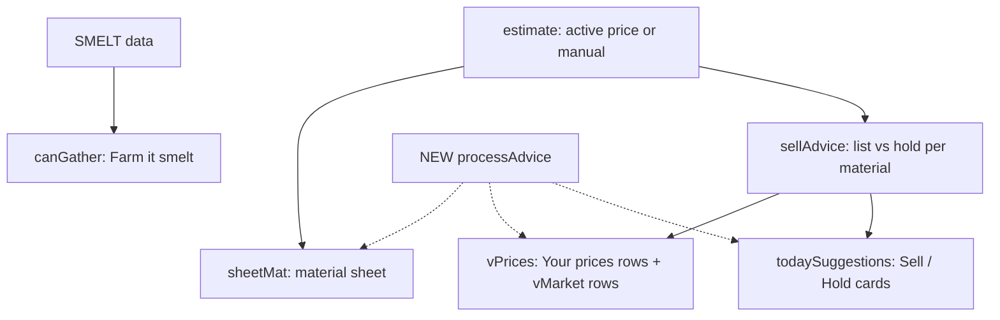

# Research: where process-or-sell hooks into the code (Nov 18, 2026)

- `src/engine/suggestions.ts` `sellAdvice(c, x)`: the material set = names you priced + gathered names with an API row. `estimate(n, items, toggles, now, apiCtx)` gives `now` (active price). Process advice should reuse the same set and the same estimate.
- `todaySuggestions` builds cards `{kind,title,body}`; the Today view renders `kind` as a pill (`KIND_PILL` in `src/ui/views.ts`). A new kind "Process" needs a pill style.
- `src/ui/views.ts` `vPrices` renders "Your prices" rows with a list/hold pill from `sellAdvice`; `vMarket` renders API rows with the same `sa` map. A process tag can join the meta pills.
- `src/ui/sheets.ts` `sheetMat` builds the material sheet: active price, sparkline, Blackwater hints, sell/buy banner. "Process or sell" section goes after the banner.
- AH cut: `cutFor(houseOf(c))` in `src/engine/character.ts` (5% faction house).
- `SMELT` (`src/data/gathering.ts`) maps bar → ores and is used by `canGather`. Recipes replace it as the source of truth, or `SMELT` derives from them so `canGather` and the dossier stay unchanged (behavior lock).
- Tests: unit tests in `tests/unit/*.test.ts` (Vitest), e2e in `tests/e2e/*.spec.ts` importing `test` from `tests/e2e/test.ts`; `servePrices` serves `tests/fixtures/prices/`.
- Reference characters have no Mining, Alchemy, Leatherworking or First Aid, so the behavior lock shouldn't move.
