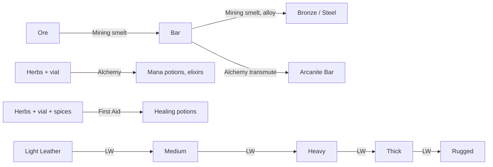

# Research: recipe data for process-or-sell (Nov 18, 2026)

Read-only lookups of public guide and database pages (WebSearch/WebFetch), no scraping or automation. Most Forever guides say they are based on the beta, so treat skill numbers as "Forever, beta-era" and verify in game when possible. `est` = not confirmed for Forever.

## Smelting (Mining)

Source for skills: [warcraft.wiki.gg, Forever mining techniques](https://warcraft.wiki.gg/wiki/Forever_mining_techniques). It gives four skill values per recipe (learn / yellow / green / grey) and inputs, but only two counts: Bronze makes 2 bars, Dark Iron takes 8 ore. Other counts are Classic (1 ore → 1 bar), `est`.

| Bar | Skill (learn/yellow/green/grey) | Inputs per craft | Out | Notes |
|---|---|---|---|---|
| Copper Bar | 1/25/47/70 | 1 Copper Ore (est) | 1 | |
| Tin Bar | 65/65/65/75 | 1 Tin Ore (est) | 1 | |
| Bronze Bar | 65/65/90/115 | 1 Copper Bar + 1 Tin Bar (est counts) | 2 | Forever yields 2 |
| Silver Bar | 75/100/112/125 | 1 Silver Ore (est) | 1 | |
| Iron Bar | 125/130/135/140 | 1 Iron Ore (est) | 1 | |
| Gold Bar | 155/170/177/185 | 1 Gold Ore (est) | 1 | |
| Steel Bar | 165/165/165/165 | 1 Iron Bar + 1 Coal | 1 | Coal count from [metabot.gg Coal](https://metabot.gg/en/wow-forever/items/coal) |
| Mithril Bar | 175/175/175/175 | 1 Mithril Ore (est) | 1 | |
| Truesilver Bar | 230/230/230/230 | 1 Truesilver Ore (est) | 1 | |
| Dark Iron Bar | 230/230/230/230 | 8 Dark Iron Ore | 1 | Black Forge, Blackrock Depths (Classic; the wiki only says high-end smelts need "specialized forges in dungeons") |
| Thorium Bar | 250/250/250/250 | 1 Thorium Ore (est) | 1 | |

Blackrock Depths minimum level: 52 in Classic, `est` (no Forever source found).

## Transmute: Arcanite (Alchemy)

- 1 Thorium Bar + 1 Arcane Crystal → 1 Arcanite Bar, Alchemy 275. Recipe sold by Alchemist Pestlezugg, Gadgetzan (Tanaris): [wow.gg Forever alchemy](https://wow.gg/professions/forever/alchemy), [metaforge (403 on fetch; search snippet says "unchanged from Classic", 275)](https://metaforge.app/wow-forever/database/recipes/recipe-transmute-arcanite).
- Cooldown: Classic Era had a 48 h cooldown, removed in patch 2.4.0 ([Wowpedia](https://wowpedia.fandom.com/wiki/Transmute:_Arcanite)). No Forever confirmation: "once every 2 days" is `est`.

## Alchemy (Forever)

Source: [wow.gg Forever alchemy](https://wow.gg/professions/forever/alchemy) (recipe, skill, reagents, source). Totals in [wow-professions Forever alchemy guide](https://www.wow-professions.com/forever/alchemy-leveling-guide) agree on ratios where they overlap (Minor/Lesser Mana, Mana, Superior Mana 2:2:1, Wisdom 1:2, Greater Intellect). Each craft makes 1 (est; no page states output counts).

Catalog names are pre-Forever for four items (T0 note): Elixir of Lion's Strength = Minor Strength, Ogre's Strength = Ogre Strength, Giants = Greater Strength, Superior Defense = Greater Defense (same item IDs).

| Output (catalog name) | Skill | Reagents per craft | Source |
|---|---|---|---|
| Minor Mana Potion | 25 | Mageroyal, Peacebloom, Empty Vial | Trainer |
| Lesser Mana Potion | 120 | Mageroyal, Stranglekelp, Empty Vial | Trainer |
| Mana Potion | 160 | Stranglekelp, Kingsblood, Leaded Vial | Trainer |
| Greater Mana Potion | 205 | Khadgar's Whisker, Goldthorn, Leaded Vial | Trainer |
| Superior Mana Potion | 260 | 2 Sungrass, 2 Blindweed, Crystal Vial | Vendor: Ulthir (Darnassus) / Algernon (Undercity), limited |
| Major Mana Potion | 295 | 3 Dreamfoil, 2 Icecap, Crystal Vial | Vendor: Magnus Frostwake (W. Plaguelands) |
| Elixir of Minor Agility | 50 | Swiftthistle, Silverleaf, Empty Vial | World drop (mobs 5–25) |
| Elixir of Lesser Agility | 140 | Wild Steelbloom, Swiftthistle, Leaded Vial | Drop (named mobs) |
| Elixir of Agility | 185 | Stranglekelp, Goldthorn, Leaded Vial | Trainer |
| Elixir of Greater Agility | 240 | Sungrass, Goldthorn, Crystal Vial | Trainer |
| Elixir of the Mongoose | 280 | 2 Mountain Silversage, 2 Plaguebloom, Crystal Vial | Drop (Jadefire / Legashi Rogues) |
| Elixir of Lion's Strength | 40 | Earthroot, Silverleaf, Empty Vial | Trainer |
| Elixir of Ogre's Strength | 150 | Earthroot, Kingsblood, Leaded Vial | Drop |
| Elixir of Giants | 245 | Sungrass, Gromsblood, Crystal Vial | Drop |
| Elixir of Wisdom | 90 | Mageroyal, 2 Briarthorn, Empty Vial | Trainer |
| Elixir of Greater Intellect | 235 | Blindweed, Khadgar's Whisker, Crystal Vial | Trainer |
| Arcane Elixir | 235 | Blindweed, Goldthorn, Crystal Vial | Trainer |
| Greater Arcane Elixir | 285 | 3 Dreamfoil, Mountain Silversage, Crystal Vial | Drop |
| Elixir of Fortitude | 150 | 4 Goldthorn, Leaded Vial | Trainer |
| Elixir of Superior Defense | 265 | 2 Stonescale Oil, Sungrass, Crystal Vial | Vendor (limited). Stonescale Oil isn't catalogued: not comparable |

Note: the page summary for Elixir of Fortitude (4 Goldthorn) differs from Classic (Wild Steelbloom + Goldthorn); mark `est` and verify.

## First Aid healing potions (Forever)

Forever moved healing potions from Alchemy to First Aid ([icy-veins news](https://www.icy-veins.com/wow-forever/news/healing-potions-now-crafted-by-first-aid-in-wow-forever/), [warcrafttavern](https://www.warcrafttavern.com/forever/guides/alchemy/)). Skills agree across [kami-labs](https://kami-labs.fr/en/guide-secourisme-wow-forever/) (checked Nov 10) and [wow.gg](https://wow.gg/professions/forever/first-aid): Minor 55, Lesser 85, Healing 135, Greater 155, Superior 215, Major 275. Reagents use new spices (Mild / Hot / Soothing Spices). **Counts conflict**: kami-labs gives 1 Peacebloom for Minor, wow.gg 3; wow.gg shows no herb counts for Healing/Greater/Superior. Spice vendor prices not found. [method.gg](https://www.method.gg/wow-forever/first-aid-in-wow-forever-1-300-leveling-guide-and-trainers) says Greater, Superior and Major come from manuals (drops / quest / vendor).

## Leatherworking conversions

Skill and source: [warcraft.wiki.gg Forever leatherworking patterns](https://warcraft.wiki.gg/wiki/Forever_leatherworking_patterns): Light 1 (automatic), Medium 75, Heavy 125, Thick 175, Rugged 225, all trainer. Ratios: Medium = 4 Light ([Wowhead Forever spell 20648](https://www.wowhead.com/forever/spell=20648)), Heavy = 5 Medium ([spell 20649](https://www.wowhead.com/forever/spell=20649)); Thick = 6 Heavy, Rugged = 6 Thick (Classic, `est`; Forever guides repeat it without a database page). Output 1 each.

## Vendor reagents (per unit)

Vendors sell vials in stacks of 5 ([warcrafttavern](https://www.warcrafttavern.com/forever/guides/alchemy/)); [outof.games](https://outof.games/forever/item/3372-leaded-vial/) lists the stack price. Per unit = stack ÷ 5, which matches the usual 4 × sell price.

| Reagent | Per unit | Source |
|---|---|---|
| Empty Vial | 4c | outof.games 3371: 20c (stack of 5), sells for 1c |
| Leaded Vial | 40c | outof.games 3372: 2s (stack of 5), sells for 10c |
| Crystal Vial | 5s | outof.games 8925: 25s (stack of 5), sells for 1s 25c |
| Coal | 5s | metabot.gg: "Buy Coal from Karm Ironquill in Loch Modan for 5s"; Classic vendor data |

## Key findings for the design

1. Every smelt, leather conversion and Alchemy output above is in the 136-item catalog (and so has API prices), except Elixir of Superior Defense's Stonescale Oil input.
2. Skill-up colors come for free for smelting (four values per recipe). For Alchemy and leather only the learn skill is known: use the app's existing `skillColor` (Classic +25/+50/+100), `est`.
3. First Aid data is too thin to give gold advice safely (conflicting counts, unknown spice prices).
4. Arcanite's cooldown in Forever is unconfirmed.
