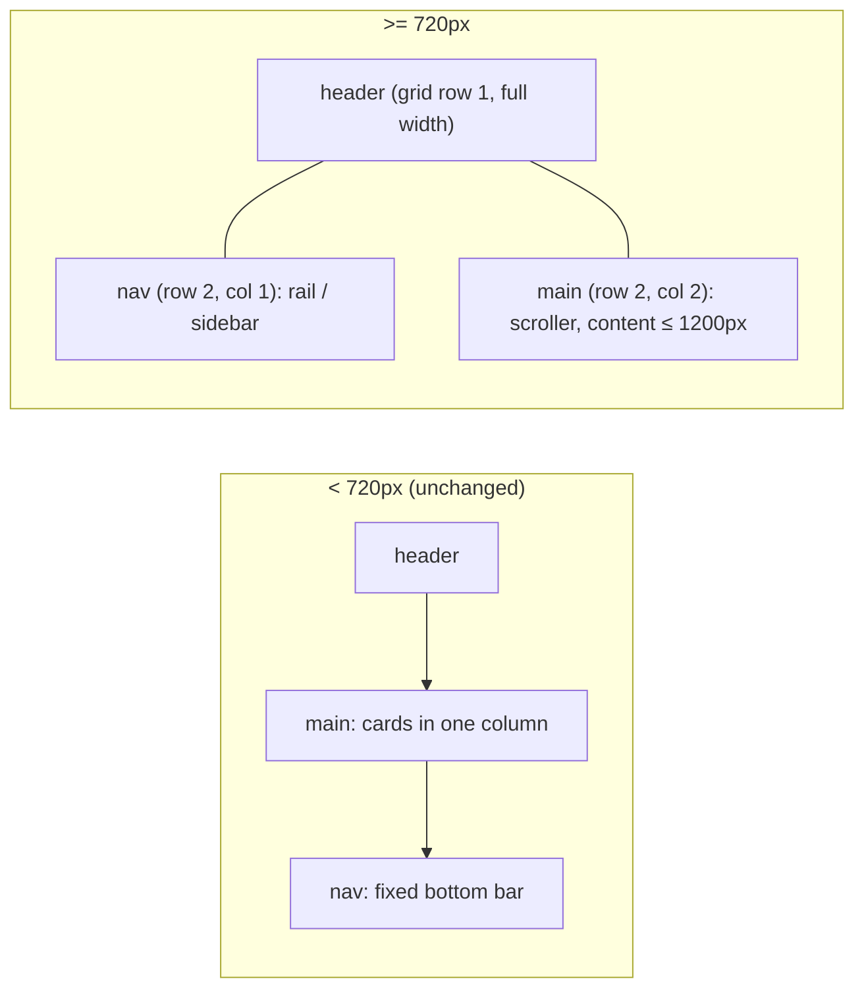
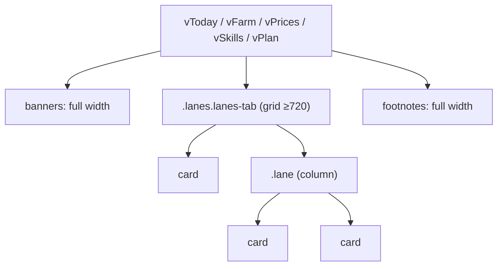

# Detailed design: responsive layout (T8)

## 1. Overview

Forever Market Ledger is a phone-first static web app (Vite + TypeScript, no framework) with five tabs (Today, Farm, Prices, Professions, Session), a header with the active character, a fixed bottom tab bar and bottom sheets. At every width it renders as a 640px phone column. This design adds a tablet layout (720–1099px) and a desktop layout (≥ 1100px): a full-width header, a side navigation rail or sidebar, multi-column card layouts per tab, and sheets as centred dialogs. The phone layout (< 720px, checked at 412px) stays pixel-identical.

The change is CSS plus small, text-free wrappers in the view templates. No engine, data or behavior changes.

## 2. Detailed requirements

### 2.1 Breakpoints
| Name | Width | Layout |
|---|---|---|
| Phone | < 720px | Today's layout, unchanged (reference width 412px) |
| Tablet | 720–1099px | Left rail, two-column tabs, centred dialogs |
| Desktop | ≥ 1100px | Labelled left sidebar, two- or three-column tabs, centred dialogs |

All new rules live inside `@media (min-width:720px)` or `@media (min-width:1100px)`. Phone rules are not edited, except for one rule that makes the new wrappers inert (`display:contents`), which has no visual effect.

A phone in landscape (~900×412) is ≥ 720px and gets the tablet layout; there are no height-based rules.

### 2.2 Shell
- **Header**: a full-width top bar above the nav and the content. Brand on the left; subtitle and price age on the same line as the title where space allows (wrapping otherwise); character chip on the right.
- **Navigation**: the same `<nav>` with the same five `data-tab` buttons.
  - Tablet: a left rail ~88px wide, icon above label, buttons stacked from the top.
  - Desktop: a left sidebar ~220px wide, icon beside label, left-aligned.
  - The active tab keeps its chip background and accent colour.
- **Content**: `main` is the only scroll container (as today; `render()` resets its `scrollTop`). Content is capped at 1200px wide and centred in the area right of the nav. The 96px bottom padding that cleared the bottom bar is dropped on wide screens.
- **Toast**: ~24px above the bottom, centred over the content area.
- **Hover**: on wide screens with a fine pointer (`hover:hover`), list rows that are buttons, zone summaries, nav buttons and `.btn` get a subtle `--chip` hover. No hover rules on phones.

### 2.3 Tabs
Banners (example character, budget) and footnotes stay full width, outside any columns.

| Tab | Tablet (720–1099) | Desktop (≥ 1100) |
|---|---|---|
| Today | Two columns: left Conditions now, Your materials today under it; right Do this | Three columns: Conditions now, Do this, Your materials today |
| Farm | Zones full width; profession cards two across | Two columns: Zones (3fr), profession cards stacked (2fr) |
| Prices | Two columns: left Your prices, Market under it; right search card | Three columns: Your prices, Market, search card; two when Market is absent |
| Professions | Auto-fit grid, columns ≥ 300px (two across) | Same grid (three across) |
| Session | Stacked, capped at 760px | Two columns: picker 320px, steps |

Columns are top-aligned; a short column does not stretch its cards. Empty-state cards ("No gathering professions", "No professions") fill the width as a single card.

### 2.4 Sheets
On tablet and desktop every sheet (material, characters + Backup, edit character) is a centred dialog: max 560px wide, max 85vh tall with its own scroll, rounded on all corners, same backdrop, same `role="dialog" aria-modal="true"` markup. Closing (Close button, backdrop click, Escape) works as today. The open animation is a short fade and scale (respecting `prefers-reduced-motion`) instead of the slide-up. Sheet contents keep their phone layout.

### 2.5 Constraints
- The 412px rendering of every tab and sheet, light and dark, is pixel-identical to `main` before the change.
- The behavior lock (`main.innerText` per tab and engine outputs, at 412px) is unchanged; no baseline re-record.
- No new class name may collide with an existing one (list in Appendix B).
- No horizontal page scroll at 412, 768, 1280 or 1920.
- `npm run check` green.

## 3. Architecture overview



At ≥ 720px, `body` becomes a two-column, two-row grid and `.app` becomes `display:contents`, so `header`, `main` and `nav` are all grid items of `body` without moving any element in the DOM:

```
body (grid: columns [rail] 1fr; rows auto 1fr; height 100%)
├── header   → row 1, columns 1 / -1
├── main     → row 2, column 2, overflow-y:auto
├── nav      → row 2, column 1, position:static
├── #sheet   (position:fixed, unaffected by the grid)
└── #toast   (position:fixed, unaffected by the grid)
```

The rail width is a custom property `--navw` (88px tablet, 220px desktop) reused by the toast's centring.

### 3.1 Tab layouts: lanes

Each view wraps its cards (not banners or footnotes) in one container, `<div class="lanes lanes-<tab>">`, and groups adjacent cards that share a column in `<div class="lane">`. Neither holds text.

- **Phone**: `.lanes, .lane { display: contents }` — they generate no boxes, so `main`'s flex column and 16px gap apply to the cards exactly as before, and `innerText` is unchanged.
- **Wide**: `.lanes` is a CSS grid (gap 16px, `align-items:start`); a `.lane` is a flex column (gap 16px, `min-width:0`) or, where a breakpoint needs it, `display:contents` or a nested grid.



Per tab:

| Tab | Markup inside `.lanes` | Tablet | Desktop |
|---|---|---|---|
| Today | Conditions, Do this, Materials (no `.lane`: the tablet grouping is not adjacent in the DOM) | 2 columns, `grid-template-rows:auto 1fr`; Conditions at (1,1), Materials at (1,2), Do this at column 2 spanning rows 1–2 | 3 equal columns, one row |
| Farm | Zones card, then `.lane` with the profession cards | 1 column; the lane is a 2-column grid | `3fr 2fr`; the lane is a flex column |
| Prices | `.lane` with Your prices + Market, then the search card | `minmax(0,1fr) minmax(0,1fr)`; the lane is a flex column | the lane is `display:contents`; `grid-auto-flow:column; grid-auto-columns:minmax(0,1fr)` gives 3 columns, or 2 without Market |
| Professions | the profession cards | `repeat(auto-fit, minmax(300px,1fr))` (340px, as first planned, leaves one column at 768: the content area there is 632px) | same |
| Session | picker card, steps card | 1 column, `max-width:760px` | `320px minmax(0,1fr)` |

Moving cards between DOM groups is not allowed: `innerText` follows DOM order, so it would change the behavior lock's text at 412px. Grid placement handles the one non-adjacent grouping (Today on tablet).

Empty states (one card, no farm list, no professions) render inside `.lanes` as a single card in the first column; the Farm and Professions empty-state cards get `grid-column:1/-1` so they span the width.

## 4. Components and interfaces

| File | Change |
|---|---|
| `index.html` | none |
| `src/styles.css` | phone: one inert rule for `.lanes, .lane`. New sections at the end: `@media (min-width:720px)` (shell, nav rail, header, toast, sheets as dialogs, lanes per tab), `@media (min-width:1100px)` (sidebar, desktop columns), `@media (min-width:720px) and (hover:hover)` (hover), and the dialog animation inside the existing `prefers-reduced-motion` guard. Update the file's header comment |
| `src/ui/views.ts` | wrap cards in `.lanes.lanes-<tab>` and `.lane` per §3.1; no text, attribute or order changes |
| `src/ui/sheets.ts`, `src/ui/actions.ts` | none expected (the dialog is pure CSS; backdrop click still hits `#sheet`) |
| `tests/e2e/screens.spec.ts` | width matrix, layout assertions, sheet screenshots |
| `tests/e2e/layout.ts` (new helper) | box-geometry helpers shared by the specs: `boxes(page, selector)` and `columnsOf(boxes)` (count of distinct left edges) |
| `docs/SPEC.md`, `CLAUDE.md`, `playwright.config.ts` | docs (T8, three layouts, check widths) |

The view functions keep their signatures. A small helper in `views.ts`, `lanes(tab, html)`, returns the wrapper string, so each view reads `lanes("today", …)`.

## 5. Data models

None. No state, storage, engine or data changes. The only new "data" are the CSS custom property `--navw` and the class names `lanes`, `lanes-today`, `lanes-farm`, `lanes-prices`, `lanes-skills`, `lanes-plan`, `lane`, and the keyframes name `pop`, all checked against existing names.

## 6. Error handling

Layout code has no runtime errors of its own. The risks and how they are contained:
- **Phone regression**: phone rules are not edited; all new CSS is behind min-width queries; wrappers are `display:contents`. Caught by the 412 pixel diff and the behavior lock.
- **Overflow at wide widths**: long names or money in narrow columns. `.lane{min-width:0}` and `minmax(0,1fr)` columns keep grid items from forcing width; `.item .nm` already wraps (`overflow-wrap:anywhere`). Caught by `scrollWidth ≤ viewport` at every width.
- **Unsupported `display:contents`**: every evergreen browser supports it; buttons inside are fine since wrappers are plain `div`s (the old accessibility bugs affected `display:contents` on buttons and semantic elements, not divs).
- **Dialog taller than the screen**: `max-height:85vh` and `overflow-y:auto` on the panel.

## 7. Testing strategy

1. **Phone pixel lock (one-off, not committed)**: before any change, a scratch Playwright spec seeds the L24 reference character at a fixed moment (`page.clock.setFixedTime`), waits for `document.fonts.ready`, and records `toHaveScreenshot` baselines at 412×900 for each tab and each of the three sheets, light and dark (16 images), into the scratchpad. After each step, the same spec compares against them with zero tolerance (`maxDiffPixels: 0`). Run from the scratchpad with its own config pointing at the same build.
2. **Behavior lock**: `tests/e2e/baseline.spec.ts` unchanged and green, no re-record.
3. **Width matrix** (`screens.spec.ts`, committed): for widths 412, 768, 1280 and 1920, light and dark, every tab and the three sheets: no page errors, `scrollWidth ≤ width`, full-page screenshot saved as `<tab|sheet>-<width>-<scheme>.png` in `test-results/`. The 412 tests keep their current names and checks.
4. **Layout assertions** (committed, written before the CSS in each step, from element boxes):
   - Shell (768, 1280): `nav` sits left of `main` (`nav.right ≤ main.left`); nav width ≈ 88 / 220; header spans the viewport; `main` content box ≤ 1200px wide at 1920.
   - Sheets (768, 1280): open panel is ≤ 560px wide and vertically centred (top gap ≈ bottom gap, ±2px); backdrop click and Escape close it.
   - Today: 3 distinct column lefts at 1280; 2 at 768, with Do this to the right of Conditions and Materials under Conditions.
   - Farm (L42 Hunter, Skinning): at 1280, zones card left of the profession lane; at 768, zones card full width and profession cards side by side when there are two or more (use a two-gatherer reference, the L15 Rogue).
   - Prices: 3 columns at 1280 with API data served (`servePrices`); 2 without Market; 2 at 768.
   - Professions: 2 columns at 768, 3 at 1280 with a character that has ≥ 3 professions.
   - Session: 2 columns at 1280, 1 at 768.
   - Phone (412): every card's left edge is the same (one column), nav is at the bottom.
5. **Manual review**: look at the saved screenshots for each width and scheme before asking to push.

## Appendix A: technology choices

| Choice | Pros | Cons |
|---|---|---|
| Plain CSS media queries (chosen) | No build or runtime change; phone rules untouched; works without JS | Per-tab column rules live in CSS, separate from the templates |
| Container queries | Components adapt to their own width | The app has one main area; viewport queries are simpler, and the grid owns the columns anyway |
| JS-driven layout (matchMedia, re-render) | Could reorder DOM per breakpoint | Changes DOM per width, risks the behavior lock, more code |
| CSS multi-column / masonry for cards | Fills gaps automatically | Masonry is not widely supported; `column-count` flows cards top-to-bottom and breaks reading order |

## Appendix B: research findings

- Layout is one 640px column: `.app`, `nav .in` and `.sheet .panel` are all capped at 640px; `main` scrolls with 96px bottom padding; the toast sits 90px up. No min-width media queries exist.
- `nav`, `#sheet` and `#toast` are siblings of `.app`, which is what makes the body grid plus `.app{display:contents}` possible without moving any markup.
- The behavior lock clicks `nav [data-tab]` and reads `main.innerText` at 412px only. CSS inside min-width queries cannot affect it; DOM wrappers can, unless they are text-free and `display:contents`. `innerText` follows DOM order, so cards cannot be regrouped across non-adjacent positions; Today's tablet layout therefore uses grid placement.
- Existing class names (avoid): `app brand asof pline charchip dot card row between muted small btn primary btns money g s c pill good warn bad acc list item nm meta right cond t fx act banner bw steps grid2 tabs stat sheet open panel out skillbar c-orange c-yellow c-green c-gray zone ww toast empty market in`; keyframes `up`. `lane`, `lanes`, `rail`, `pop` are unused.
- References: HTML Standard, innerText getter (https://html.spec.whatwg.org/multipage/dom.html#the-innertext-idl-attribute); CSS Display Level 3, `display: contents` (https://www.w3.org/TR/css-display-3/#valdef-display-contents); CSS Grid Level 1 (https://www.w3.org/TR/css-grid-1/); Media Queries Level 4, `hover` (https://www.w3.org/TR/mediaqueries-4/#hover).

## Appendix C: alternatives considered

- **Top tab bar** instead of a side rail: simpler, but it competes with the header for vertical space, which is scarce on a landscape tablet.
- **Material sheet as a right side panel**: lets you compare with the list, but a modal backdrop blocks clicks on other rows; making it non-modal needs new focus and click handling. Deferred.
- **Uncapped content width**: more columns at 1920 but long lines and sparse cards; capped at 1200px instead.
- **Brand in the desktop sidebar**: separates brand from the character chip; kept a single full-width header for both wide layouts.
- **Recording new baselines**: rejected; a layout change must not touch tab text.
