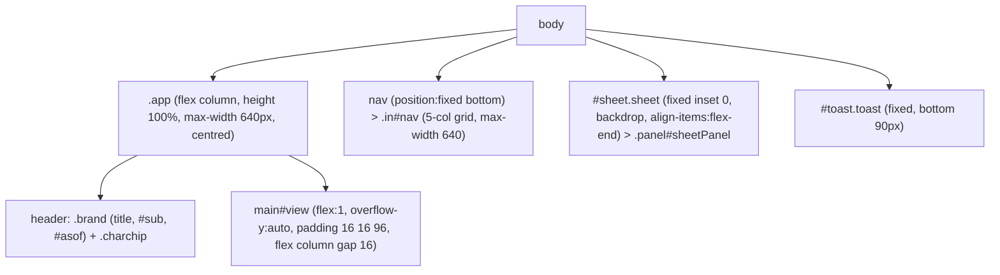

# Research: the current layout code (Nov 18, 2026, `main` at 8c8bd10)

## DOM (index.html)

- `nav` and `#sheet` and `#toast` are siblings of `.app`, not inside it.
- `render()` writes `banners(c) + vTab(c)` into `#view` and sets `#view.scrollTop=0`. Each `vTab` returns a string of `<section class="card">`s plus, on Farm and Professions, trailing `
` footnotes.
- Sheets: `openSheet(html)` fills `#sheetPanel` and adds `.open`; `closeSheet()` removes it. Backdrop click (`e.target.id==="sheet"`) and Escape close. Three sheets: material (`sheetMat`), characters + Backup (`sheetChars`), edit character (`sheetChar`).

## Cards per tab, in DOM order

| Tab | Cards (in order) | After the cards |
|---|---|---|
| Today | Conditions now, Do this, Your materials today | — |
| Farm | Zones for … (only if a farm list exists), one card per gathering profession (1–3); or a single "No gathering professions" card | two footnotes |
| Prices | Your prices, Market (only for US characters with API data), search card (input + Relevant/Matches) | — |
| Professions | one card per profession (up to 7); or "No professions" | one footnote |
| Session | length picker, steps | — |

Today's tablet grouping (Conditions + Materials left, Do this right) groups cards that are **not adjacent** in the DOM. Moving them would change `main.innerText` order at 412px and break the behavior lock, so that one layout uses grid placement (Do this spans two rows) instead of a lane wrapper.

## CSS facts (src/styles.css, 121 lines)

- No `@media (min-width…)` rules exist. Only `prefers-color-scheme` and `prefers-reduced-motion` (keyframes `up`).
- Widths tied to the phone column: `.app{max-width:640px}`, `nav .in{max-width:640px}`, `.sheet .panel{max-width:640px;max-height:88%;border-radius:18px 18px 0 0}`, `main` bottom padding 96px (clears the nav), `.toast{bottom:90px}`, `.item .right{max-width:45vw}`.
- Class names in use (avoid reusing): `app brand asof pline charchip dot card row between muted small btn primary btns money g s c pill good warn bad acc list item nm meta right cond t fx act banner bw steps grid2 tabs stat sheet open panel out skillbar c-orange c-yellow c-green c-gray zone ww toast empty market in`. `lane`, `lanes`, `rail` appear nowhere in `src/` (grep, Nov 18, 2026).

## Tests that touch layout

- `playwright.config.ts`: viewport 412×900, New York time, production build on port 4173.
- `tests/e2e/capture.ts` (behavior lock): clicks `nav [data-tab="…"]`, reads `main.innerText`; runs at the config viewport only (412). So CSS inside `min-width:720px` cannot affect it; DOM wrappers can, unless they hold no text and render as if absent.
- `tests/e2e/screens.spec.ts`: each tab, light and dark, at 412; asserts `scrollWidth ≤ 412` and no page errors; saves full-page screenshots to `test-results/`.
- `tests/fixtures/reference.ts`: `CHARACTERS`, `MOMENTS`, `seedFor(c)` for seeding `fml-cache`.

## innerText and `display:contents`

`innerText` follows DOM order and adds line breaks for block-level boxes. A `display:contents` element generates no box, so it adds no line breaks of its own; its children (`section`, `p`) produce the same breaks as before. Expected result: identical text at 412. The behavior lock and the 412 pixel diff both confirm this in step 4. Reference: HTML Standard, "The innerText getter steps" (https://html.spec.whatwg.org/multipage/dom.html#the-innertext-idl-attribute); CSS Display 3, `display: contents` (https://www.w3.org/TR/css-display-3/#valdef-display-contents).
