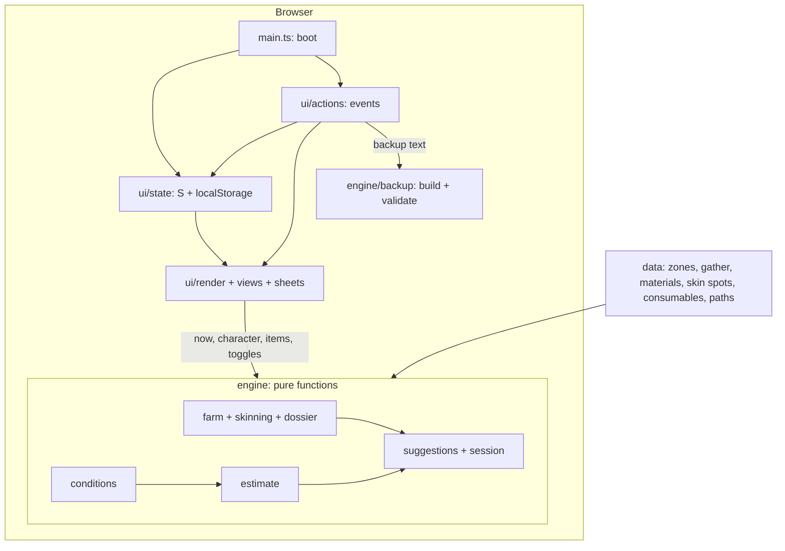
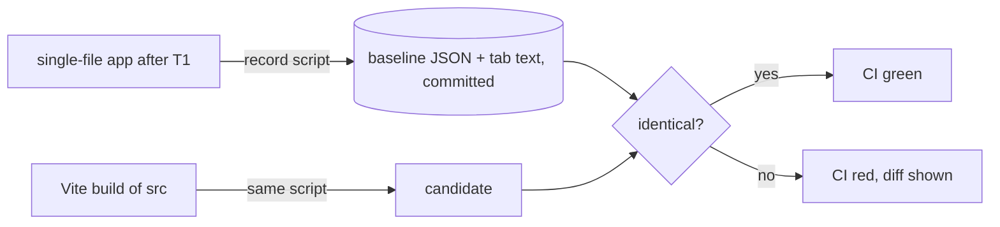

# Detailed design: standalone mode (T1) and modules with tests (T2)

Forever Market Ledger, Nov 18, 2026.

## 1. Overview

Forever Market Ledger is a phone-first planner for World of Warcraft: Forever. Today it is one 907-line HTML file that was built and hosted as a claude.ai artifact, and it now also runs on GitHub Pages at https://koollan.github.io/forever-market-ledger/.

This design covers two backlog tasks, done in order, each on its own branch and pull request:

- **T1, standalone mode:** a Backup section to export and import all saved data as versioned JSON. It is added to the existing single file, so the same build can be pasted into the claude.ai artifact and the user can carry their data out of claude.ai into the GitHub Pages site.
- **T2, modules and tests:** the single file becomes a TypeScript project (Vite, Vitest, Playwright) with a pure engine, a separate UI, and CI that gates deploys. Behavior must not change, which is proved by recording the app's outputs before the split and comparing after. The claude.ai-only features (Ask Claude, the claude.ai database) are removed, and the single file is deleted at the end.

## 2. Detailed requirements

### T1
1. A **Backup** section at the bottom of the character sheet (opened from the header's character chip).
2. **Export** shows the full backup as JSON in a read-only text box with a **Copy** button. If the clipboard is refused (as it can be inside an embedded frame), the text is selected so the user can copy it by hand, and a message says so.
3. **Import** is a paste box and an Import button. The paste is validated as a whole first. Any problem shows one plain message and changes nothing (all or nothing). Unknown extra fields are ignored; a newer `version` than the app knows is refused.
4. A valid paste shows a confirmation with counts, e.g. "Replace with 3 characters and 41 prices?". Confirming replaces all characters, the active character, condition switches and prices.
5. Works the same inside claude.ai (where data lives in its database) and standalone (browser storage).
6. The Ask Claude card is hidden when the app runs outside claude.ai (no `window.claude`). This also keeps the T2 baseline, recorded outside claude.ai, free of the card that T2 removes.
7. Acceptance: on GitHub Pages the app loads with no console errors; data survives reload; export, clear, import round-trips exactly.

### T2
1. Split into `src/data` (tables), `src/engine` (pure logic) and `src/ui` (DOM, storage, events), in TypeScript, built by Vite into a static `dist/` for GitHub Pages.
2. **Pure engine:** no `Date.now()`, no DOM, no shared mutable state. Every engine function takes `now` and the data it needs as arguments.
3. **Behavior unchanged:** before the split, record the engine outputs and the visible text of every tab for three reference characters at three fixed times. After the split, the new build must produce identical outputs and text.
4. The three reference characters become permanent tests: L15 Alliance Rogue (Herbalism 90, Skinning 80), L24 Horde Hunter (Skinning 120), L42 Horde Hunter (Skinning 205), expecting top zones Darkshore, The Barrens and Feralas.
5. Unit tests for `skinReq`, `skinPlan`, `whereGather`, `reachZones`, `shiftAt` (weekend, midweek, raid prep), `estimate` de-conditioning, sell windows, `sessionPlan` allocation, and backup validation.
6. Playwright screenshots of every tab at 412×900, light and dark, uploaded from CI for human review (they guard against the past bug that squeezed a title to one letter per line).
7. Remove Ask Claude and the claude.ai database; browser storage is the only storage. Existing stored data keeps loading.
8. CI on every pull request and push runs typecheck, unit tests and Playwright. The Pages deploy runs the same checks and deploys only if they pass.
9. At the end of T2, delete the single-file app; the claude.ai artifact is retired once the user has exported their data.
10. Acceptance: tests green in CI; built output is still a static site.

### Out of scope
Sync across devices, home auction house selection, realm time zones (T7), any price pipeline (T3), any change to rules or numbers.

## 3. Architecture overview



The rendering layer reads the clock once per render and passes `now` down. The engine never reads globals, so the same calls can be made from tests with a fixed time.

### Behavior-lock flow



The record script runs in Playwright with a fixed clock (`page.clock.setFixedTime`), a fixed time zone (`timezoneId: "America/New_York"`), and browser storage seeded with the reference characters and a small set of prices before the page loads.

## 4. Components and interfaces

### 4.1 T1 inside the single file

- `buildBackup(state, items, now)` returns the backup object (section 5).
- `validateBackup(text)` returns `{ok: true, backup, counts: {characters, prices}}` or `{ok: false, error}`. Pure; no side effects.
- `applyBackup(backup)` replaces `S.state` and `S.items`, writes browser storage, and in claude.ai writes the `state` document and every price document, then deletes price documents not in the backup.
- Character sheet: a Backup section with Export (box + Copy) and Import (paste box + Import → confirm card with counts → Replace / Cancel).

### 4.2 T2 module layout

| Module | Contents | Rules |
|---|---|---|
| `src/data/*.ts` | Zones, gather tables, stones, leather tiers, skin specials, skin spots, density, consumables, houses, ranks, paths, smelting, gather rates, materials catalog, launch date | Plain typed constants, no logic beyond building the catalog |
| `src/engine/util.ts` | `median`, `keyOf`, `plainMoney` | Pure |
| `src/engine/conditions.ts` | `frontLevel`, `ctxAt`, rules, `shiftAt`, `windows(m, toggles, mode, hours, now)` | Pure; local time as today |
| `src/engine/estimate.ts` | `estimate(name, items, toggles, when)` | Pure |
| `src/engine/farm.ts`, `skinning.ts`, `dossier.ts`, `character.ts` | `reachZones`, `whereGather`, `canGather`, `rankBlock`, `skinReq`, `skinPlan`, `skinSpots`, `skinLine`, `continentOf`, `zoneDossier` | Pure; take `character`, `now`, `items`, `toggles` as needed |
| `src/engine/suggestions.ts` | `gatherOptions`, `bestFarm`, `sellAdvice`, `needsFor`, `todaySuggestions`, `sessionPlan` | Pure |
| `src/engine/backup.ts` | `buildBackup`, `validateBackup` (moved from T1) | Pure |
| `src/ui/state.ts` | `S`, `activeCharacter`, `saveState`, `cacheLocal`, `readLocal` | Only module that touches storage |
| `src/ui/format.ts` | `money` (HTML), `esc`, `ago(t, now)` | DOM-free string building |
| `src/ui/views/*.ts`, `src/ui/sheets/*.ts` | `vToday`, `vFarm`, `vPrices`, `vSkills`, `vPlan`, material sheet, character sheets incl. Backup | Read `now` from the render call |
| `src/ui/actions.ts`, `src/main.ts` | Event listeners, boot | Boot reads `fml-cache` only |

Signature convention: an engine function that used to read `Date.now()` or `S` gets a trailing context argument, e.g. `todaySuggestions(c, {now, items, toggles})`, so call sites stay readable and new inputs don't reorder parameters.

### 4.3 Test harness

- `tests/fixtures/reference.ts`: the three characters, three fixed times (Wed Nov 18 2026 14:00, Sat Nov 21 19:00, Mon Nov 23 18:00, all America/New_York), and a small fixed price set (e.g. Peacebloom, Briarthorn, Medium Leather, Iron Ore, Mageweave Cloth, each with two dated entries) so estimates and sell advice are exercised.
- `tests/baseline/record.spec.ts`: Playwright script that, for each character × time, loads the app, captures each tab's visible text and the engine outputs (evaluated in the page), and writes `tests/baseline/*.json`. Run once against the single file after T1 and committed.
- `tests/baseline/compare.spec.ts`: runs the same capture against the Vite build and requires exact equality with the committed baseline.
- `tests/screens.spec.ts`: 412×900 screenshots of each tab, light and dark.
- `tests/unit/*.test.ts`: Vitest unit tests for the engine and backup validation.

### 4.4 CI

- `.github/workflows/ci.yml` on pull requests and pushes: install, `tsc --noEmit`, Vitest (with `TZ=America/New_York`), build, Playwright (Chromium), upload screenshots and any diff as an artifact.
- `.github/workflows/pages.yml` on `main`: the same checks, then upload `dist/` and deploy.

## 5. Data models

### Stored state (unchanged by both tasks)

```ts
type Character = {
  id: string; name: string; cls: string; level: number; // 1–60
  faction: "Alliance" | "Horde"; region: "us" | "eu";
  gold: number | null;       // copper; null = estimate by level
  stretch?: number;          // zone reach +0..+5, default 2
  skyborne?: boolean;
  profs: { name: string; skill: number }[]; // skill 0–300
  example?: true;            // the built-in example character
};
type PriceEntry = { t: number; price: number }; // Unix ms, copper
type PriceItem = { key: string; name: string; hist: PriceEntry[] }; // last 60 kept
type AppState = { characters: Character[]; activeId: string; toggles: Record<string, boolean> };
// localStorage["fml-cache"] = { state: AppState, items: Record<string, PriceItem> }
```

### Backup, version 1

```json
{
  "app": "forever-market-ledger",
  "version": 1,
  "exportedAt": 1795046400000,
  "characters": [ ],
  "activeId": "ex",
  "toggles": {},
  "prices": { "item~peacebloom": {"key": "item~peacebloom", "name": "Peacebloom", "hist": [{"t": 1794950000000, "price": 82}]} }
}
```

`activeId` and `toggles` are included so the round trip is exact (without `activeId`, import would reset the active character). `toggles` is always `{}` today because no control sets it.

Validation rules: `app` equals `"forever-market-ledger"`; `version` is an integer and ≤ 1; `characters` is a non-empty array, each with string `id` and `name`, known `cls`, integer `level` 1–60, `faction` Alliance or Horde, `profs` an array of `{name, skill 0–300}`; `activeId` matches a character; `prices` is an object whose values have a string `name` and a `hist` array of `{t: number, price: number ≥ 0}`. Unknown fields are ignored and not kept.

## 6. Error handling

| Situation | Behavior |
|---|---|
| Paste is not JSON, or is cut off | "That isn't a complete backup. Copy the whole text from Export and try again." Nothing changes |
| Wrong `app`, missing or newer `version` | "This backup is from a newer version of the app" / "This isn't a Forever Market Ledger backup." Nothing changes |
| A character or price fails validation | One message naming the first problem, e.g. "Character 2 has no level." Nothing changes |
| Clipboard write refused | Select the text in the box; message "Copy blocked here; the text is selected, copy it by hand" |
| Browser storage full or blocked | Keep data in memory for the session; toast "Couldn't save on this device"; Export still works |
| claude.ai database write fails during import (T1 only) | Browser storage is already written; toast that the claude.ai copy may be out of date; retry on next save |
| Corrupt `fml-cache` on boot | Same as today: ignore it and start with the example character; prices without a valid history are dropped |

## 7. Testing strategy

- **Behavior lock (T2's main proof):** baseline text and engine JSON from the single file, compared exactly with the Vite build, 3 characters × 3 times. Any difference fails CI and the diff is uploaded.
- **Reference characters:** a permanent test that each one's top zone is Darkshore, The Barrens or Feralas at the weekday fixed time.
- **Unit tests:** the engine functions listed in requirement T2.5, written against the pure modules with fixed `now` and `TZ=America/New_York`. Each rule in the conditions table gets a case (weekend from Friday 17:00, midweek, raid prep Monday 17:00 on day ≥ 14, prime time, quiet hours, clamp 0.6–1.6).
- **Backup:** round-trip test (build → stringify → validate → apply → build equals original), and a failing case for each validation rule.
- **T1 manual check:** in the claude.ai artifact and on Pages: export, clear site data, import, compare.
- **Screens:** 412×900 screenshots, light and dark, reviewed by a person on each PR.

## Appendices

### A. Technology choices

| Choice | Pros | Cons |
|---|---|---|
| TypeScript | Catches mismatched data and rule shapes as you type; documents the data model | Build step; types for loosely shaped legacy tables take some care |
| Vite | Outputs a plain static folder; `base` setting handles the Pages subpath | One more tool than plain modules |
| Vitest | Same config as Vite; fast; runs pure engine tests in Node | None significant |
| Playwright | Fixed clock (`setFixedTime`), time zone per context, storage seeding, screenshots; one script records the baseline from the old file and checks the new build | Browser download in CI (~1 min) |

References: [Vite on GitHub Pages](https://vite.dev/guide/static-deploy#github-pages), [Playwright clock](https://playwright.dev/docs/clock), [Playwright emulation](https://playwright.dev/docs/emulation).

### B. Research findings

- The script has 16 labelled sections that map cleanly to data, engine and UI modules. Only rendering and two helpers (`$`, `toast`) touch the DOM.
- The engine reads the clock in 6 places (`windows`, `estimate`, `recordPrice`, suggestions, `zoneDossier` twice) and reads global state in `estimate` and the suggestion functions. These become arguments.
- `ctxAt` uses device-local day and hour, so every condition rule depends on the device's time zone. T2 keeps this (realm time is T7) and pins the zone in tests.
- `money` returns HTML; it moves to the UI and the engine returns numbers.
- Storage is one browser-storage key (`fml-cache`) holding `{state, items}`; inside claude.ai the same shapes live in its database and win on boot.

### C. Alternatives considered

- **Pure refactor vs fix-as-you-go:** fixing bugs during the split would make every output difference ambiguous. Rejected; fixes come after T2.
- **Pixel-diff screenshots as the behavior check:** fragile across fonts and machines. Rejected in favor of exact text plus engine JSON.
- **Best-effort import:** would silently delete skipped records, because import replaces everything. Rejected.
- **Switching rules to realm time during T2:** a behavior change; deferred to T7.
- **Keeping the claude.ai host:** means maintaining code paths nobody uses. Rejected once data carry-over is possible.

### D. Constraints and limits

- The baseline is only as good as its fixtures: 3 characters × 3 times plus a small price set. Paths it doesn't exercise (e.g. Skyborne characters, EU region) are covered by unit tests instead, not by the behavior lock.
- The time zone is pinned to America/New_York in tests; real users see their own local time, as today.
- In claude.ai the file picker and possibly the clipboard are blocked, so export is copy-from-a-box.
