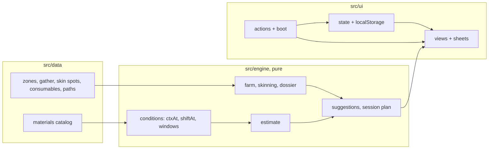

# Research: how `app/index.html` is built today

Read on Nov 18, 2026 from commit `7ae5b67`. 907 lines: CSS (lines 10–127), markup, and one inline `<script>` (lines 141–905).

## Sections

| Lines | Section | Goes to (T2) |
|---|---|---|
| 143–250 | Reference data (classes, professions, gather tables, zones, stones, leather tiers, consumables, houses, budget, `reachZones`, `whereGather`) | `src/data/*` (tables), `src/engine/farm.ts` (functions) |
| 251–267 | Helpers: `$`, `esc`, `keyOf`, `money`, `plainMoney`, `ago`, `toast`, `median`, `uid8` | split: pure ones to `src/engine/util.ts`; `$`, `toast`, `money` (returns HTML) to `src/ui` |
| 268–299 | Storage (`Store`, `cacheLocal`, `readLocal`) | `src/ui/storage.ts`, localStorage only (claude.ai `db` removed) |
| 300–322 | Materials catalog (`LAUNCH`, `MATS`, `MAT`, `RAW`, `CONSUME`, `FA_HERBS`) | `src/data/materials.ts` |
| 323–371 | Conditions engine (`frontLevel`, `ctxAt`, `RULES`, `shiftAt`, `windows`, `whenTxt`) | `src/engine/conditions.ts` |
| 372–389 | Prices you enter (`itemFor`, `lastPrice`, `estimate`, `recordPrice`, `deletePrices`) | `src/engine/estimate.ts` + `src/ui/prices.ts` |
| 390–419 | Character helpers (`RANKS`, `PATHS`, `SMELT`, `GATHER_RATE`, `canGather`, `rankBlock`) | `src/data` + `src/engine/character.ts` |
| 420–453 | Suggestions (`gatherOptions`, `bestFarm`, `sellAdvice`, `needsFor`, `todaySuggestions`, `sessionPlan`) | `src/engine/suggestions.ts` |
| 454–501 | Skinning spots (`SKIN_SPOTS`, `skinReq`, `skinPlan`, `skinSpots`, `skinLine`) | `src/data/skinSpots.ts` + `src/engine/skinning.ts` |
| 502–607 | Zone dossiers (`continentOf`, `DENSITY`, `zoneDossier`) | `src/engine/dossier.ts` |
| 608–615 | App state `S` and `char()` | `src/ui/state.ts` |
| 616–772 | Rendering: `vToday`, `vFarm`, `vPrices`, `vSkills`, `vPlan`, `render` | `src/ui/views/*` |
| 773–851 | Sheets (material sheet, character list and editor) | `src/ui/sheets/*` |
| 852–866 | Claude brief (`getSample`, `doBrief`) | removed |
| 867–887 | Actions (delegated click/input/keydown listeners) | `src/ui/actions.ts` |
| 888–904 | Boot (local cache first, then claude.ai `db` if present) | `src/main.ts`, local only |

## What makes the engine impure today (the T2 work)

1. **Clock reads inside engine code.** `Date.now()` appears in `windows` (362), `estimate` (380), `recordPrice` (385), `sellAdvice`/`todaySuggestions` (428), `zoneDossier` (509, 570), plus rendering (644, 658, 694, 778) and `ago` (263). Each engine function needs a `now` argument; rendering passes one `now` per render.
2. **Global state reads inside engine code.** `estimate` reads `S.items` (via `itemFor`) and `S.state.toggles`; suggestion functions read `S.state`. These become arguments (`items`, `toggles`, `character`).
3. **Local time zone.** `ctxAt` uses `getDay()`/`getHours()`, so weekend, midweek, raid-prep, prime-time and quiet-hours rules depend on the device's zone. To keep behavior unchanged, T2 keeps local time (realm time is T7). Tests must therefore pin a time zone, or the same `now` gives different results on different machines.
4. **HTML in helpers.** `money` returns HTML; the engine must return numbers and let `src/ui` format them.
5. **DOM use is confined** to `$`, `toast` and lines 616+. Nothing in the engine sections touches the DOM, so the split is mostly mechanical once 1–2 are done.

## Ask Claude and claude.ai storage to remove

- `Store.init/load/save/remove` db branches (268–295), boot's db load (893–902), `S.sample`, `S.brief`, `getSample`, `doBrief`, the `brief` action, and the Ask Claude card in `vToday`.
- After removal, `Store` reduces to `cacheLocal`/`readLocal` on key `fml-cache`.
