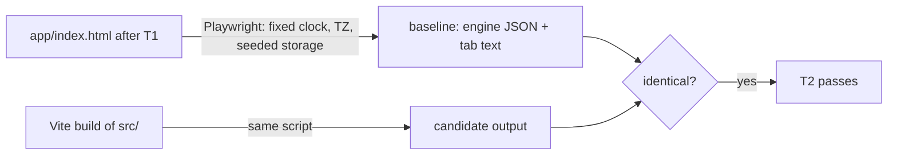

# Research: build, test and deploy tooling

## Vite on GitHub Pages
- The site lives under `/forever-market-ledger/`, so `vite.config.ts` needs `base: "/forever-market-ledger/"` ([Vite: deploying to GitHub Pages](https://vite.dev/guide/static-deploy#github-pages)).
- `vite build` writes a plain static `dist/`; the Pages workflow uploads `dist` instead of `app` (`actions/upload-pages-artifact` with `path: dist`).
- No runtime dependencies are needed; the app stays dependency-free in the browser.

## Vitest
- Engine modules are pure TypeScript, so tests run in Node with no DOM.
- Because `ctxAt` uses local time (see existing-code.md), tests pin the zone with `TZ`. On Windows the npm script needs a cross-platform way to set it (e.g. set `process.env.TZ` in a Vitest `globalSetup` file before modules load). Proposed zone: `America/New_York` (US realms).

## Playwright
- `page.clock.setFixedTime(date)` makes `Date.now()` and `new Date()` return a fixed time while timers still run ([Playwright: clock](https://playwright.dev/docs/clock)).
- The browser zone is set per context with the `timezoneId` option ([Playwright: emulation](https://playwright.dev/docs/emulation)).
- Seeding the three reference characters is a matter of writing `fml-cache` into `localStorage` before the page loads (`page.addInitScript`).
- With a fixed clock, a fixed zone and seeded storage, the same Playwright script can record the "before" text from the current `app/index.html` (served statically) and check the Vite build against it. No change to the legacy file is needed to record the baseline.
- On GitHub Actions: `npx playwright install --with-deps chromium`, then upload screenshots with `actions/upload-artifact`.

## Engine outputs in the baseline
The legacy file has no module exports, so engine JSON for the baseline is taken by evaluating the script in a page and calling the functions with the fixed clock, the same way the T0 backfill script read `MATS` with `node:vm`. After the split, the new modules are called directly in Vitest.
