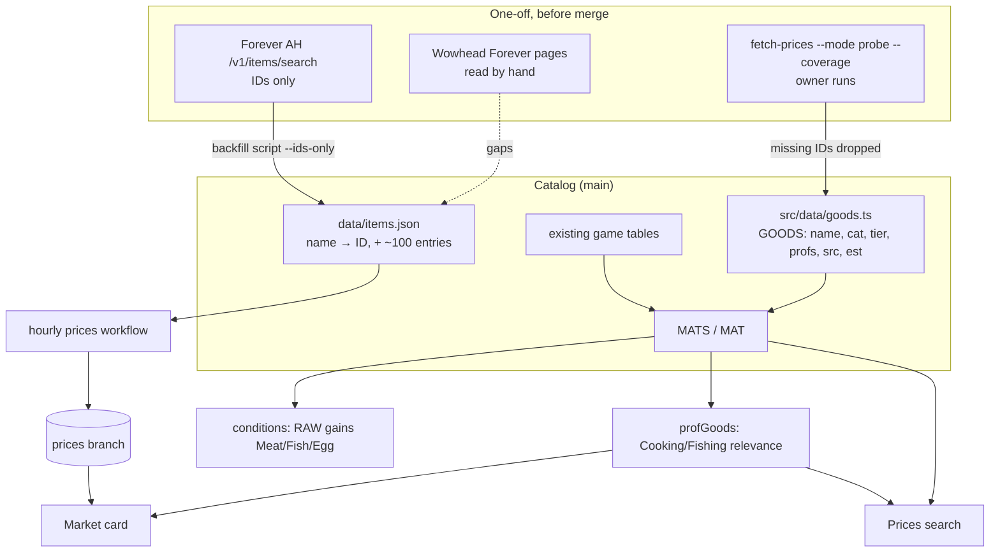

# Detailed design: T11, wider catalog

## 1. Overview

Forever Market Ledger knows 136 materials: herbs, skins, ore, cloth, bars, Enchanting materials and consumables. Popular auction goods outside that set can't be found in Prices search and get no hourly prices. Examples are Chunk of Boar Meat, other meats, fish, eggs, elementals and gems. T11 adds a curated list of about 100 such goods to the catalog. Each one has a sourced category and tier, and each is confirmed to be an auction-house commodity in Blizzard's own data. The hourly pipeline then prices them with no extra requests.

## 2. Detailed requirements

1. **Scope:** a curated list of about 100 auction-traded goods:
   - Cooking materials (meats, eggs, raw fish)
   - drop-based trade goods (elementals such as Elemental Earth and Heart of Fire, essences, gems, oils and similar)

   Vendor-only goods (thread, flux, dyes, spices, vials) stay out; their fixed prices belong to the `VENDOR` table. Cataloguing every commodity is out of scope and may become a later task.
2. **Only scanned items:** an item joins the catalog only if its ID appears in Blizzard's commodities response for at least one US house. There are no free-text or manual-only items. The check runs once before the merge. An item that sells out later stays listed.
3. **Names and IDs:** a one-time lookup through Forever AH's `/v1/items/search`, within its stated limits (~1 request/second), fetching IDs only and no history. The owner allowed it on Nov 19, 2026, and it is logged in `docs/SOURCES.md`. Hand-read Wowhead Forever item pages fill any gaps. Forever's in-game name is the catalog name.
4. **Sources:** every item cites where its category and tier come from (a code comment per item or group, and `docs/SOURCES.md`). Guessed tiers are marked `est: true`.
5. **Categories and rules:**
   - `Meat`, `Fish` and `Egg` are raw materials: they join `RAW` and get the weekend (−7%) and midweek (+4%) shifts.
   - `Elemental` and `Trade good`, plus gems under the existing `Gem` category, are in neither `RAW` nor `CONSUME`, so they get only the tier rules (leveling front, endgame demand) and the time-of-day rules.
   - Tier (1–6) follows the existing level-bracket rule (`floor(level/10)+1`), applied to the level of the beasts or zones the item comes from.
6. **Where items show up:**
   - All new items are searchable in Prices.
   - For a character with Cooking, Meat, Egg and Fish count as relevant (Market card and the unsearched list); for a character with Fishing, Fish does.
   - Farm, Professions, Today and Session are unchanged. Fishing spots, beast drops and Cooking skill paths are T6.
7. **Pipeline:** the only change to collection is the bigger `data/items.json`. The `prices` branch and `latest.json` grow about 1.7×, which the owner accepted.
8. **Behavior lock:** `tests/e2e/baseline.spec.ts` stays unchanged. If it changes, stop and ask the owner instead of re-recording.
9. **Not in T11:** renaming the four renamed elixirs (T6), Cooking or First Aid recipes, EU.
10. **Backlog:** SPEC gains T11, and SPEC §8 Q3 reads "Only the catalogued materials (catalog widened in T11)".

## 3. Architecture overview



## 4. Components and interfaces

### 4.1 `src/data/goods.ts` (new)
- `GOODS: Good[]`: the curated list, grouped by category, with a source comment per group.
- Pure data. It doesn't import from `materials.ts`, to avoid a cycle.

### 4.2 `src/data/materials.ts`
- `MATS` appends `GOODS` (name, cat, tier, plus `profs`).
- `RAW` gains `Meat`, `Fish` and `Egg`.
- `Material` gains an optional `profs?: string[]`.

### 4.3 `src/engine/character.ts`
- `profGoods(c: Character): string[]` returns the names of `MATS` whose `profs` include one of the character's professions. Pure, with no skill threshold: the skill gates live in T6's Cooking paths.

### 4.4 `src/ui/views.ts`
- The `relevant` set in `vPrices` adds `profGoods(c)`. It flows on into `vMarket` unchanged. No markup changes.

### 4.5 `scripts/backfill-forever-ah.mjs`
- `--ids-only`: looks up null IDs as today, writes `data/items.json`, and stops before any history request. It reports names with no exact hit.

### 4.6 `src/pipeline/coverage.ts` (new, pure) and probe
- `coverage(houses: {id: number; ids: Iterable<number>}[], catalog: Set<number>) → {missing: number[]; untracked: number; perHouse: {id, tracked, untracked}[]}`.
- `fetch-prices.ts --mode probe --coverage` reads every house's `/commodities` (17 requests) and prints the missing catalog names and IDs plus the distinct untracked count. It prints only names, IDs and counts. The owner runs it, since the credentials never leave their terminal.

## 5. Data models

```ts
// src/data/goods.ts
export type GoodCat = "Meat" | "Fish" | "Egg" | "Elemental" | "Gem" | "Trade good";
export type Good = {
  name: string;          // Forever's in-game name
  cat: GoodCat;
  tier: number;          // 1–6, floor(level/10)+1 of the source beasts/zone
  profs?: ("Cooking" | "Fishing")[];  // relevance only
  est?: true;            // tier is a guess
};
// one comment per group: "// Source: <url or guide>, read Nov 2026"
```

`data/items.json` keeps its shape (`{"_source": "...", "<name>": <id>}`). The `_source` note says the T11 entries came from the same lookup on their own date, and that Wowhead was used where named in `docs/SOURCES.md`.

No storage changes. Characters, Backup and `fml-prices` keep their shapes. Prices are keyed by name, and new names don't collide with old ones (tested).

## 6. Error handling

| Case | Handling |
|---|---|
| Forever AH search has no exact name match | Check the Forever name on Wowhead by hand. If found, record the ID with Wowhead as its source; otherwise drop the item. |
| Two items share a name, or a search hit has a different name | Use the commodity one confirmed by the coverage report. Note a rename in the list. |
| Forever AH rate limit or outage | The existing retry/backoff in the script applies. Rerun later; already-recorded IDs are skipped. |
| A catalog ID is absent from every house | Drop it from `GOODS` and `data/items.json` before merging, and note it in the item list. |
| Item missing from `latest.json` after merge | The app already shows "No API price yet" and falls back to manual prices. |
| A name clashes with an existing material | Unit test fails; fix the list. |
| Behavior lock changes | Stop and tell the owner why; don't re-record. |

## 7. Testing strategy

- **Unit (Vitest):**
  - `goods.test.ts`: unique names, no clash with the other `MATS`, tier 1–6, category in `GoodCat`, `profs` only on Meat/Egg/Fish.
  - `data.test.ts` and `items.test.ts`: the count becomes `136 + GOODS.length`, and items.json matches `MATS` as today.
  - `coverage.test.ts`: missing and untracked counts over small fixtures, including an empty house with no `auctions` key.
  - `conditions.test.ts`: a Meat item gets the weekend shift; an Elemental doesn't.
  - `character` tests: `profGoods` returns Fish for Fishing, Meat/Egg/Fish for Cooking, and nothing for the reference characters.
- **E2E (Playwright, 412×900):** searching "boar" in Prices finds Chunk of Boar Meat; a Cooking character's unsearched list includes a meat. A new `tests/e2e/catalog.spec.ts` checks this with the price fixture extended for one new item.
- **Behavior lock:** unchanged, which proves no rule or wording moved for the reference characters.
- **Manual:** the owner runs the coverage probe once and pastes its output into the PR.

## 8. Appendices

### A. Technology choices
- **Curated data file instead of generated:** keeps a source on every row and the `est` marks visible. The cost is hand-editing about 100 rows.
- **Pure `coverage()` plus a thin probe flag:** follows the pipeline's pattern (pure in `src/pipeline`, network in `scripts`) and is testable without credentials.

### B. Research findings
- The pipeline reads `data/items.json` from `main` on each run, and `upsert` pads mid-day additions with `null`. Adding IDs needs no workflow or file-format change.
- `latest.json` is about 105 KB for 136 items, so about 0.8 KB per item. With about 100 more it lands around 180 KB, smaller over gzip.
- The count tests (`136`) and the exact `items.json` = `MATS` test must change together in one commit.
- Blizzard's static item API 404s for many Forever items, so it can't supply names.
- The number of distinct commodities in the scan is unknown; the coverage report will print it, which informs any later "whole scan" task.

### C. Alternatives considered
- **Every commodity in the scan:** deferred. It needs a name, category and tier for each of an unknown number of items (likely hundreds or more), and `latest.json` would reach several MB unless split per house.
- **Free-text manual items:** rejected by the owner. Only items in the scan are listed.
- **Folding into T6:** rejected. T11 changes the pipeline's scope and a SPEC decision, not just game data.
- **Forever AH history for the new items:** rejected to keep the exception minimal. History starts with the first hourly run.
