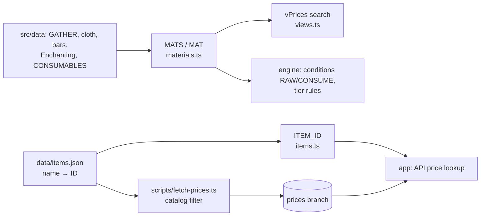

# Existing code touched by T11

Read on Nov 19, 2026 at `main` 1b988af.

- **Catalog:** `MATS` in `src/data/materials.ts` is built in code from the game tables. Each `Material` is `{name, cat, tier, gather?, req?, lvl?}`. `RAW` = Herb, Leather, Hide, Scale, Ore, Stone, Cloth; `CONSUME` = Potion, Elixir, Consumable. Category `Gem` already exists for mining crystals and is in neither set.
- **Count assertions:** `tests/unit/data.test.ts` expects exactly 136 `MATS` and 136 unique `MAT` names. `tests/unit/items.test.ts` expects the names in `data/items.json` to match `MATS` exactly, with unique positive integer IDs and a `_source` note.
- **Search:** `vPrices` (`src/ui/views.ts:150`) shows `MATS` that aren't tracked yet, filtered by substring when there's a query and by `relevant` (`gatherOptions(c)` + `needsFor(c)`) when there isn't. It shows up to 30, each with "cat · tier". `vMarket` gets the same `relevant` set.
- **Pipeline:** `catalog()` in `scripts/fetch-prices.ts` reads `data/items.json` from the checked-out `main`, so new IDs are picked up by the next hourly run with no workflow change. `upsert` in `src/pipeline/files.ts` pads items that are new partway through a day file with `null`, so a mid-day addition is safe.
- **Probe:** `--mode probe` reads the token, the ruleset and house indexes, and two houses (`PROBE_HOUSES`), with and without `/commodities`. `describeAuctions` summarizes listings against the catalog IDs. It doesn't count distinct untracked IDs and doesn't read all houses.
- **ID lookup:** `scripts/backfill-forever-ah.mjs` looks up any `data/items.json` name with a null ID through `/v1/items/search` (exact name match, with a `KNOWN_IDS` fallback for renames), then downloads hourly and daily history. It has no IDs-only mode.
- **Behavior lock:** `tests/e2e/baseline.spec.ts` records each tab's text for three reference characters, none with Cooking or Fishing, and no search query. A larger catalog should leave it unchanged unless a new item becomes relevant to one of them.
