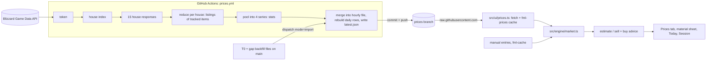

# Detailed design: Blizzard API price pipeline (T3)

Forever Market Ledger, Nov 18, 2026.

## 1. Overview

Forever Market Ledger is a phone-first planner for World of Warcraft: Forever, a static TypeScript site on GitHub Pages (https://koollan.github.io/forever-market-ledger/). Its engine (`src/engine`) is pure: functions take `now` and their data as arguments. Today its only prices are the ones the player types in, stored on the device in `localStorage` (`fml-cache`).

T3 adds real auction house prices from the Blizzard Game Data API:

- A **GitHub Actions workflow** runs hourly, reads all 15 US WoW Forever auction houses, reduces the listings of the 136 catalogued materials to six stats per item, and commits them to an orphan **`prices` branch** as hourly and daily files.
- The **app** fetches the newest prices and a 24-hour history from that branch at runtime, caches the last good copy on the device, and uses the API price unless the player entered a newer one in the last 24 h.
- The earlier **T0 backfill** (Forever AH's public API, US region-wide view, hourly from Nov 13, 2026 17:00 UTC) is converted into the same format, so the calibration task (T4) has history from Nov 13.

T3 ships as two pull requests in sequence: **PR A** (`t3/pipeline`) starts data collection as early as possible, because GitHub runs scheduled workflows only from `main` and T4 needs 2+ weeks of data; **PR B** (`t3/app`) makes the app use it.

## 2. Detailed requirements

### Pipeline (PR A)
1. **Source:** Blizzard Game Data API, host `https://us.api.blizzard.com`, namespace `dynamic-forever-us`, ruleset 2. Auth by OAuth client credentials. Region is a parameter; only `us` is configured.
2. **Houses:** read all 15 US houses every run and store **four series**: `alliance` (110, 111, 112, 119, 123), `horde` (113, 114, 115, 120, 124), `blackwater` (116, 117, 118, 121, 125), and `all` (the 15 pooled). A series pools the listings of its houses; it never averages per-house stats. Per-house series are not stored (no public mapping tells a player which of the five faction houses they use).
3. **Items:** only the 136 catalogued materials, by item ID from `data/items.json` (catalog name → item ID). No calls to Blizzard's static item API.
4. **Stats per item per point:** `min, p10, p25, median, qty, listings`. Unit prices in copper. Percentiles are weighted by quantity. Only listings with a buyout count (bid-only skipped); a regular auction's unit price is `buyout / quantity`, a commodity's is `unit_price`. `listings` is the number of auctions, `qty` the sum of their quantities. Items with no listings in a series get `null`.
5. **Schedule:** hourly at minute :17 UTC, plus manual `workflow_dispatch`. A point is keyed by Blizzard's snapshot hour, not the run time. If no house's snapshot changed since the last stored point, the run writes nothing.
6. **Storage:** an orphan `prices` branch with `us/latest.json`, `us/{series}/hourly/{yyyy-mm-dd}.json` and `us/{series}/daily/{yyyy-mm}.json` (section 5). Hourly files are kept indefinitely. Each run rebuilds the daily rows for yesterday and today (UTC) from the hourly files.
7. **Repo size:** on the 1st of each month the workflow replaces the `prices` branch history with a single commit of its current files (force-push to `prices` only, never `main`).
8. **Failures:** each request retries 3 times with backoff (429 and 5xx retryable, honoring `Retry-After`). A house that still fails is left out of the run; each point records how many houses it pooled. If the token or the house index fails, nothing is written and the run fails, so GitHub emails the repository owner. No other alerting. Gaps stay gaps; nothing is interpolated.
9. **T0 conversion:** a one-off conversion turns `data/backfill/forever-ah/us-all/*.json` into `us/all/` hourly and daily rows, tagged as source `fah`, with `p25` and the house count `null`. The gap between T0's end (Nov 19 00:00 UTC) and the first T3 run is closed by one more run of the backfill script at Forever AH's stated limits (about 1 request/second), after the first T3 run has succeeded, so the two overlap. Where a Forever AH row and a Blizzard row share an hour, the Blizzard row wins. Recorded in `docs/SOURCES.md`.
10. **Secrets:** `BNET_CLIENT_ID` and `BNET_CLIENT_SECRET` as repository secrets, created by the owner. The agent never sees or handles their values. A `probe` mode of the workflow logs response shapes, counts and header names only.

### App (PR B)
11. **Loading:** the app fetches `us/latest.json` and today's and yesterday's hourly files of the character's home series from `https://raw.githubusercontent.com/Koollan/forever-market-ledger/prices/` at boot and again when the tab becomes visible if the cached copy is over 30 min old. The last good copy lives in a new `localStorage` key `fml-prices` (not in `fml-cache`, so Backup is unchanged). Fetch failure keeps the cached copy; no cache and no network means the app behaves exactly as before T3.
12. **Home series:** the character's faction (`alliance` or `horde`). EU characters stay on manual prices; their material sheet says "API prices are US only for now".
13. **Which price is active:** a manual entry wins while it is newer than the latest API point and less than 24 h old. Otherwise the API's `p10` for the home series is the active price. With no API value, the existing manual estimate is used unchanged. Manual entries are never deleted.
14. **Advice:** buy and sell windows use the active price as their base, with the same conditions engine on top (T4 recalibrates the conditions).
15. **Material sheet:** active price with its source ("API · 40 min ago" or "You · 2 h ago"), `min` and `median` for context, a 24-point `p10` sparkline of the home series, and the Blackwater hint when Blackwater beats the home house by more than 5%: selling, "Blackwater: 1g 20s after 15% cut, 8% better"; buying, "Blackwater: 1g 02s, 6% cheaper".
16. **Prices tab:** manual entries as now, plus a **Market** list of API prices for the materials this character gathers or needs for their professions (not all 136).
17. **Freshness:** a "prices as of 14:17" line; past 3 h it reads as stale ("prices from 5 h ago").
18. **Mobile:** every new element checked at 412 px wide, light and dark.

### Acceptance
- PR A: after merge and secrets, scheduled runs commit hourly points for all four series; the conversion puts Nov 13 onward into `us/all`.
- PR B: after 24 h of data, the app shows real current prices and a 24-point history for tracked materials; the files support per-weekday and per-hour analysis for T4.
- The behavior lock (`tests/e2e/baseline.spec.ts`) stays byte-identical with the price fetch stubbed empty. CI never calls Blizzard or Forever AH.

## 3. Architecture overview



**Why an orphan branch fetched at runtime:** commits made with `GITHUB_TOKEN` do not trigger other workflows, and `main` deploys only after all checks pass. Keeping data off `main` leaves its history and the deploy gate untouched, and new data reaches users within the hour without a rebuild. `raw.githubusercontent.com` serves with open CORS, gzip and about 5 minutes of caching.

**Code split:** the pipeline's logic is pure TypeScript in `src/pipeline/` (tested by Vitest like the engine); `scripts/fetch-prices.ts` does network and file work and runs with Node 24's built-in TypeScript type stripping, so the workflow needs no `npm ci`. The app side follows the existing rule: pure rules in `src/engine/market.ts`, fetch and storage in `src/ui/prices.ts`.

## 4. Components and interfaces

### 4.1 `src/pipeline/` (pure, no I/O)
To run under Node's type stripping, these files use only erasable TypeScript (no enums or parameter properties) and import each other with explicit `.ts` extensions (`allowImportingTsExtensions` in `tsconfig.json`; `noEmit` is already set). They import nothing from `src/ui`.

| Module | Interface |
|---|---|
| `houses.ts` | `SERIES: Record<SeriesId, number[]>` for US; `seriesOf(houseId)` |
| `reduce.ts` | `listingsFrom(houseJson, tracked: Set<number>): Map<itemId, Listing[]>` where `Listing = {unit, qty}`; accepts both auction and commodity shapes; skips bid-only. `stats(listings): Row \| null`, with `Row = [min, p10, p25, median, qty, listings]` |
| `series.ts` | `pool(perHouse: Map<houseId, Map<itemId, Listing[]>>, houses): {houses: number, items: Record<itemId, Row \| null>}` |
| `files.ts` | `mergeHourly(file \| null, point): HourlyFile` (insert or replace by `ts`; `bnet` replaces `fah`, never the reverse); `rollDay(hourly, date): DailyRow`; `mergeDaily(file \| null, date, row)`; `buildLatest(points, snapshots)` |
| `snapshot.ts` | `pointHour(snapshots): string` (latest house snapshot, floored to the hour, ISO UTC); `changed(prevSnapshots, snapshots): boolean` |
| `convert-t0.ts` | `convertT0(files): {hourly: Map<date, HourlyFile>, daily: Map<month, DailyFile>}` for series `all`, source `fah` |

### 4.2 `scripts/fetch-prices.ts` (I/O)
```
node scripts/fetch-prices.ts --mode run|probe|import --out <prices checkout> [--region us]
```
- **run:** token → index → each house (sequential, about 1 per second; snapshot from the `Last-Modified` header, else run time floored to the hour) → if `changed`, reduce, pool, merge files, write → exit 0. Prints one summary line, e.g. `2026-11-20T15:00Z 15/15 houses, 131/136 items`.
- **probe:** token → index → one house and its `/commodities` sub-path; logs top-level keys, auction counts, whether tracked items appear in `auctions` or `commodities`, and response header names. Writes nothing.
- **import:** reads the T0 and gap backfill files from the `main` checkout, converts them and merges them into `us/all`, then rebuilds the affected daily rows.
- Credentials come only from the environment (`BNET_CLIENT_ID`, `BNET_CLIENT_SECRET`) and are never printed. The token is kept in memory only.

### 4.3 `.github/workflows/prices.yml`
- Triggers: `schedule: '17 * * * *'` (run), `schedule: '47 0 1 * *'` (squash), `workflow_dispatch` with input `mode` (`run`, `probe`, `import`, `squash`).
- `permissions: contents: write`, the only workflow with write access. `concurrency: {group: prices, cancel-in-progress: false}` so runs and the squash never overlap. `timeout-minutes: 15`.
- Steps: check out `main`; check out `prices` into `./prices`, or create it as an orphan if it doesn't exist; set up Node 24; run the script; if `git status` shows changes, commit as `github-actions[bot]` with the summary line and push to `prices`.
- **Squash:** in `./prices`, create an orphan commit of the current tree ("prices: history squashed <date>"), then `git push --force-with-lease origin HEAD:prices`.

### 4.4 `src/engine/market.ts` (pure)
```ts
type Market = { latest: Latest | null; hourly: Record<SeriesId, HourlyFile[]> };
type Active = { price: number; source: "api" | "manual"; at: number; stale: boolean; row?: Row };
homeSeries(c: Character): SeriesId | null            // alliance | horde; null for EU
activePrice(name, {items, market, character, now}): Active | null
history(name, series, market, now, points = 24): (number | null)[]   // p10, newest last
blackwaterHint(name, {market, character, cut}): {mode: "sell" | "buy", price: number, pct: number} | null
asOf(market, now): {ts: number, stale: boolean} | null              // stale past 3 h
```
`estimate(name, items, toggles, when, market?)` gains an optional last argument. When `activePrice` returns an API price, `now = p10` and `base = p10 / shiftAt(now).mult`, so windows and sell advice keep their formula (`base × shift(t)`). With `market` absent or empty, `estimate` behaves exactly as today.

### 4.5 `src/ui/prices.ts`
- `PRICES_URL` constant, the `raw.githubusercontent.com` base above.
- `loadPrices(region, series, now)`: fetch `latest.json` and two day files with a 10 s timeout; on success save `{fetchedAt, latest, hourly}` to `fml-prices` (only the home series and the last 2 days); on failure return the cache. Never throws.
- Called from `main.ts` after the first render. The UI re-renders when prices arrive; the first paint never waits on the network.

### 4.6 UI changes
- Material sheet: price line with source label; `min · median` line; inline SVG sparkline (no library), full width, single column at 412 px; Blackwater hint; EU note.
- Prices tab: **Market** section under the manual list, rows "name · price · as of", tapping opens the material sheet.
- Header: "prices as of …" line, with a stale state.
- `SugCtx` gains `market`; `sellAdvice`, `todaySuggestions` and `sessionPlan` pass it to `estimate`.

## 5. Data models

### `data/items.json` (on `main`, bundled)
```json
{ "_source": "Item IDs from Forever AH /v1/items/search (T0, Nov 18 2026)", "Peacebloom": 2447, "Silverleaf": 765 }
```

### Hourly file: `us/{series}/hourly/{yyyy-mm-dd}.json` (one UTC day)
```json
{
  "v": 1, "region": "us", "series": "horde", "date": "2026-11-20",
  "fields": ["min", "p10", "p25", "median", "qty", "listings"],
  "ts": ["2026-11-20T00:00:00Z", "2026-11-20T01:00:00Z"],
  "src": ["bnet", "bnet"],
  "houses": [5, 4],
  "items": { "2447": [[12, 15, 18, 25, 4210, 96], null] }
}
```
`ts`, `src`, `houses` and every item's row list are aligned by index and sorted by `ts`. Items are keyed by item ID (stable through Forever's renames). An item with no listings at that hour is `null`. Converted T0 rows have `src: "fah"`, `houses: null` and `p25: null`.

### Daily file: `us/{series}/daily/{yyyy-mm}.json`
Same header, with `date` replaced by `month`, `ts` holding day starts (`2026-11-20T00:00:00Z`), plus `n` (hours pooled per day). Each daily row: `min` = lowest hourly `min`; `p10`, `p25`, `median` = medians of the hourly values; `qty`, `listings` = means of the hourly values, rounded. `src` is `bnet`, `fah` or `mixed`. Converted T0 daily points are kept as Forever AH gave them for days with no Blizzard hours (Nov 13 starts at 17:00 in the hourly data, so the provider's daily point is better).

### `us/latest.json`
```json
{
  "v": 1, "region": "us", "ts": "2026-11-20T15:00:00Z", "generated_at": "2026-11-20T15:18:02Z",
  "snapshots": { "110": "2026-11-20T15:04:11Z" },
  "fields": ["min", "p10", "p25", "median", "qty", "listings"],
  "series": { "alliance": { "houses": 5, "items": { "2447": [12, 15, 18, 25, 4210, 96] } } }
}
```

### `fml-prices` (device)
`{v: 1, fetchedAt, region, latest, hourly: {[series]: HourlyFile[]}}`. Not part of Backup; safe to clear.

### Size
About 100 KB per series per day uncompressed (136 items × 24 rows), so about 12 MB a month on disk for four series. A phone loads `latest.json` (about 20 KB) and two day files of one series (about 50 KB gzipped). The monthly squash keeps git history at roughly the size of the files.

## 6. Error handling

| Situation | Behavior |
|---|---|
| Token request fails (bad secret, outage) | Retry ×3, then exit 1, nothing written; GitHub emails the owner |
| House index fails or is empty | Same as above |
| One house fails after retries | Run continues; series record `houses` below their full count (5 or 15); summary line names the missing houses |
| Response missing `auctions` (houses 112, 115, 118 at times) | Treated as zero listings for that house, which still counts as included |
| 429 | Wait for `Retry-After` (default 10 s), counts as a retry |
| No snapshot changed | Exit 0, no commit |
| Two runs in one snapshot hour with new data | Row for that `ts` replaced |
| Delayed or skipped scheduled run | Next run writes its own snapshot hour; missing hours stay absent |
| Push rejected (race) | Concurrency group prevents overlapping runs; on rejection, the run fails and the next hour retries |
| Malformed or unknown file version in the app | Ignored; app falls back to cache, then to manual-only |
| Offline or fetch timeout in the app | Cached copy, with its age shown; stale label past 3 h |
| No API value for an item | Manual estimate as before; Market list omits the item |

## 7. Testing strategy

- **Pipeline unit tests (Vitest):** a small recorded house fixture (trimmed real shapes from the probe, both auction and commodity forms, a bid-only auction, a house without `auctions`). Tests for weighted percentiles on hand-checked listings, `null` for no listings, pooling of 5 houses vs averaging (must differ), `mergeHourly` insert, replace and source precedence, `rollDay` on a day with gaps, `changed`, `pointHour` flooring, and `convertT0` on one real T0 file (row count, `p25` null, Blizzard wins on overlap).
- **Script:** `--mode run` against a local fixture directory (an env var points the script at a file server or fixture loader), checking the files written. No real network in CI.
- **Engine unit tests:** `activePrice` (manual newer and under 24 h wins; older than 24 h or older than the API point loses; no API value falls back), `estimate` with and without `market` (without, identical to today's outputs), `blackwaterHint` thresholds and cut, `asOf` staleness, `homeSeries` for EU.
- **Behavior lock:** `baseline.spec.ts` stubs `raw.githubusercontent.com` with 404 and must stay byte-identical. No `RECORD_BASELINE` in T3.
- **New e2e (412×900, light and dark):** stubbed `latest.json` and day files for a reference character; checks the Market list, the material sheet price line, sparkline and Blackwater hint, and the stale label with the clock moved 5 h ahead. Screenshots land in `test-results/` as now.
- **Manual:** after PR A merges, a `probe` dispatch and then a `run` dispatch; check the commit on `prices`. After PR B deploys, open Pages on a phone and check a material's price against Forever AH by eye.

## 8. Appendices

### A. Technology choices
| Choice | Pros | Cons |
|---|---|---|
| Node 24 type stripping for the script | No build step or `npm ci` in the cron; shares typed code with Vitest | Erasable syntax and `.ts` imports only in `src/pipeline` |
| Orphan `prices` branch | `main` stays clean; no deploy per hour; data independent of code | Needs a write-permission workflow and a monthly force-push |
| `raw.githubusercontent.com` at runtime | Fresh within minutes, CORS open, gzip | Not a guaranteed CDN; about 5 min cache; the app must survive its absence (it does) |
| Columnar JSON | Readable, easy per-hour and per-weekday slicing in T4, small | Rewrites the whole day file each hour (bounded by the squash) |

### B. Research findings
- Endpoints (from developer probing; Blizzard has not documented Forever): index `/data/wow/ruleset/{id}/auctions/` (trailing slash required), house `/data/wow/ruleset/{id}/auctions/{houseId}`, commodities `/…/{houseId}/commodities`, namespace `dynamic-forever-{region}`. Every ruleset returns the same 15 houses. Sources: [Blizzard forum thread](https://us.forums.blizzard.com/en/blizzard/t/wow-forever-api-what-works-so-far-plus-a-ts-client/60334), [Everloot PR #867](https://github.com/Everloot/everloot/pull/867).
- House IDs and factions from Forever AH's `GET /v1/houses` (Nov 19, 2026): Alliance 110, 111, 112, 119, 123; Horde 113, 114, 115, 120, 124; Blackwater 116, 117, 118, 121, 125. 122 does not exist.
- Busy houses: 50–68k auctions, about 9 MB per response. Some houses omit `auctions`. 43% of Forever item IDs 404 on the static item endpoint.
- Auth: `POST https://oauth.battle.net/token`, Basic auth, `grant_type=client_credentials`, 24 h token, `Authorization: Bearer`. Limits 36,000/hour and 100/second ([rate limits](https://us.forums.blizzard.com/en/blizzard/t/api-access-clients-rate-limits/5602)). A run uses about 18 requests.
- Snapshots refresh about once an hour per house (Forever AH's `last_snapshot` times).
- GitHub: public repos run standard runners free; schedules run only from the default branch and can be delayed; `GITHUB_TOKEN` pushes don't trigger workflows.
- T0 data: Forever AH's unified US view, fields `min_unit, p10_unit, median_unit, mean_unit, quantity, listings`, hourly with some missing hours. Its percentile method is not documented, so `fah` and `bnet` rows may differ slightly for the same market; T4 should test for a step at the switch-over (both are tagged per row).

### C. Alternatives considered
- **Track only the region-wide view** (matches T0): simplest, but can't serve the per-faction home house or the Blackwater hint.
- **Track all 15 houses separately:** 4× the storage, and nobody can tell which faction house is theirs.
- **Bundle data into the build on `main`:** 24 gated deploys a day and a noisy `main`; data would lag a full CI run.
- **Deploy data into the Pages artifact from the cron:** either skips the deploy gate or reruns all checks hourly.
- **Delete hourly data after 7 days (the spec's first idea):** T4 needs per-hour effects over 2+ weeks, and hourly files are small.
- **Manual always wins, or blend manual and API:** a stale manual entry would hide live data; blending mixes one player's single observation with market-wide stats.
- **Static item API for names:** unnecessary for 136 known IDs and unreliable for Forever.
