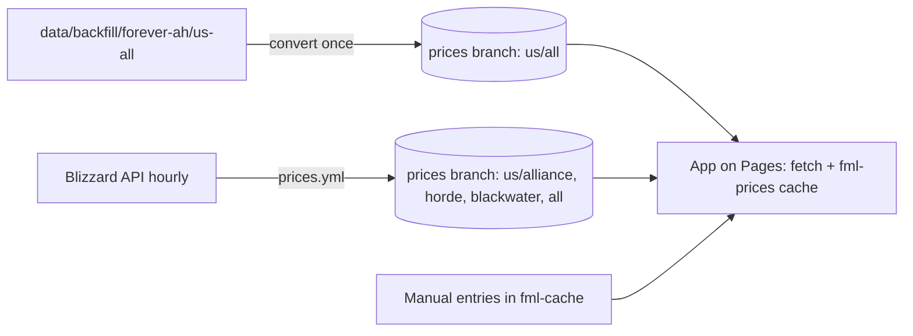

# Research: existing price data and code

## T0 backfill files
`data/backfill/forever-ah/us-all/{itemId}.json`, 136 files, 4.3 MB total. Shape:

```json
{
  "source": "forever-ah", "credit": "...", "fetched_at": "2026-11-19T00:33:35.707Z",
  "name": "Thorium Ore", "forever_name": "Thorium Ore", "item_id": 10620,
  "house": {"house_key": 17, "region": "us", "ruleset_id": 2, "house_id": 0, "name": "All Auction Houses", "house_type": "unified"},
  "hourly": {"resolution": "hour", "points": [{"ts": "2026-11-13T17:00:00Z", "min_unit": 1232, "p10_unit": 1334, "median_unit": 1789, "mean_unit": 3134, "quantity": 8868, "listings": 288}]},
  "daily":  {"resolution": "day",  "points": [{"ts": "2026-11-13T00:00:00Z", "...": "same fields"}]}
}
```

- Hourly: up to 126 points, Nov 13 17:00 to Nov 19 00:00 UTC, with some missing hours (e.g. 19:00 on Nov 13 for Thorium Ore).
- Daily: 7 points from Nov 13.
- No `p25`; has `mean_unit`, which T3 drops.
- `data/backfill/forever-ah/item-ids.json`: catalog name → item ID for all 136 materials.

## App price code
- `src/engine/types.ts`: `PriceEntry {t, price}` (Unix ms, copper), `PriceItem {key, name, hist}`, `Items` keyed by `keyOf(name)`.
- `src/engine/estimate.ts`: `estimate(name, items, toggles, when)` de-conditions each manual entry (`price / shiftAt(t).mult`), takes the median as base, and multiplies by `shiftAt(when)`.
- `src/ui/state.ts`: `localStorage` key `fml-cache` holds `{state, items}`; Backup exports the same.
- `src/data/consumables.ts`: `HOUSES` with the AH cuts (faction 5%, Blackwater 15%).

## Tests and CI
- e2e fixes the clock with `page.clock.setFixedTime`; the app makes no network calls today, so the T3 fetch needs a `page.route` stub so the baseline stays offline and deterministic.
- `ci.yml` (PRs, branches other than `main`) and `pages.yml` (`main`, gated deploy) both have `contents: read`. A new `prices.yml` needs `contents: write`.


